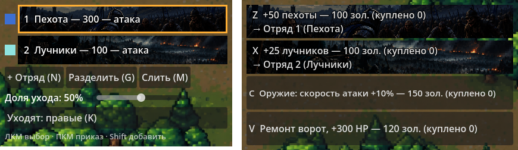

# Задача 16: размеры кнопок, читаемость и хвосты

Коммиты: этапы A–C и этап D (этот отчёт) — см. `git log`. Симуляция не менялась: регрессия против эталона бит в бит (эталон не обновлялся), regress_hero против main.gd до задачи (fd98818) — бит в бит (49 ударов, 56 добитых, без дерева и с кадрами эффектов).

## Этап A: фиксированные размеры кнопок

**data/ui_layout.json** (меняется без кода; неверное поле — предупреждение и значение по умолчанию):

| поле | значение | что |
|---|---|---|
| shop_button_size | [448, 56] | кнопки магазина (все пять, и «Оружие», «Ворота») |
| squad_button_size | [352, 48] | кнопки отрядов (цветной квадрат 18×18 слева — как был) |
| action_button_height | 36 | «+ Отряд», «Разделить», «Слить», «Уходят: …» |
| war_cry_size | [300, 40] | кнопка Клича (полоса под ней — той же ширины) |

**Итоговые размеры на экране 1920×1080 (проверено смоуком):**
- магазин — все кнопки ровно 448×56;
- отряды — 352×48;
- Клич — 300×40;
- кнопки действий — высота 36.

Ширина больше не зависит от текста.

**Подгонка текста** (`_fit_text`, пересчёт только при смене текста):
- сначала кегль уменьшается от 16 до 11, пока строки не поместятся без переноса;
- если не помещаются и на 11, текст переносится по словам: берётся самый крупный кегль, при котором он помещается в две строки;
- кнопка при этом не растягивается: включены clip_text и перенос по словам.

**Что получилось сейчас:**
- магазин ru: кегли 16 / 16 / 15 / 16 — «Оружие: скорость атаки +10% — 150 зол. (куплено 0)» ужалось до 15 и стоит в одну строку;
- магазин en: все 16;
- отряды: 16, со «● Стена щитов» — 15;
- у пехоты и лучников в магазине по две строки («→ Отряд 1 (Пехота)»), как и раньше.

**Панели не выходят за экран.** 8 отрядов, один из них со «Стеной щитов», плюс кнопки действий, деление, подсказка и Клич занимают панель 374×596 px с y = 242. Магазин целиком на экране.

**Полосы иллюстраций** перегенерированы под новые пропорции (`bench/make_unit_portraits.gd` теперь берёт размеры кнопок из ui_layout.json):
- `art/ui/<тип>_896x112.png` — магазин, 2× от 448×56. Из crop (0, 330, 1536×219) берётся середина 1536×192 (y 343);
- `art/ui/<тип>_704x96.png` — отряды, 2× от 352×48. Середина 1536×209 (y 335);
- прежние 640×88 и 520×80 удалены;
- crop в unit_portraits.json не менялся: пропорции кнопки он получает сам, как и раньше (середина crop).

## Этап B: читаемость

- **Градиент в data/unit_portraits.json:** `gradient_left_alpha` 0.45 у левого края → `gradient_right_alpha` 0.0 на доле `gradient_width` 0.6 ширины кнопки, правее — без затемнения.
  - Общая текстура для всех кнопок, поэтому смена значений в файле действует на все сразу.
  - Неверное значение — предупреждение и значение по умолчанию. Типы юнитов в том же файле, ключи `gradient_*` типами не считаются.
- **Общего затемнения картинки нет:** в обычном состоянии яркость 1.0, при наведении 1.3. Серая и темнее (×0.55) только недоступная кнопка. Контур текста 4 px.
- **Три варианта** (ширина 0.6; слева панель отрядов с выбранным отрядом 1, справа магазин; 1:1, снято с экрана 1920×1080). Скрипт: `bench/shots_v66_gradient.gd <папка>`, файлы данных он не меняет.

**0.45 / 0.0** (сейчас в файле):

**0.55 / 0.1:**

**0.35 / 0.0:**

Разница между вариантами небольшая: сами иллюстрации в полосе тёмные (ночное небо, грязь, тёмные доспехи), поэтому текст читается во всех трёх. Картинку больше светлит смена crop, чем градиент.

## Этап C: хвосты

- **Карточка 44:** «Из последних сил» / «Against the Odds». Теперь название не совпадает ни с одной карточкой ни на ru, ни на en (проверка в check_v64).
  - В задании сказано «совпадало с №7», на деле совпадало с №17 «Последний рубеж» (ворота ниже 30%). №17 осталась как была.
  - Переводы переимпортированы.
- **Радиус карточки 45 перенесён в data/hero.json:** `hero_near_radius` 150. Ключ добавлен одной строкой после `revive_hp_fraction`, ваши значения в файле не тронуты. В рабочей копии незакоммиченных правок не было: hp 35 уже в fd98818.
  - В cards.json у условия больше нет `radius`: `"when": {"cond": "hero_near"}`. Карточка с `radius` в `when` теперь не проходит валидатор.
  - Если `hero_near_radius` в hero.json нет, берётся 150. Число ≤ 0 — ошибка загрузки hero.json.
  - Описание карточки и подсказка в HUD берут число из hero.json: в переводе стоит `{hero_near_radius}`, его подставляет `CARDS.fill_desc` (экран выбора, HUD).

## Этап D: проверка

- **Полный run_all:** PASS, 59 шагов, 894 с.
- **Тесты.** check_v65 и smoke_v65_art дополнены:
  - размеры из ui_layout.json и подгонка кегля;
  - кнопки ровно заданного размера, текст помещается;
  - 8 отрядов и Клич на экране;
  - градиент из файла.

  check_v64 и smoke_v64_cards:
  - имя №44 на ru и en;
  - hero_near без radius в карточке;
  - радиус и описание — из hero.json;
  - граница radius ± 1 px.
- **FPS, волна 10 с героем** (view_v47 hero). «До» — fd98818 в новом временном worktree, 4 пары поочерёдно:
  - до: 950.6 / 902.6 / 975.3 / 963.6 (среднее 948.0);
  - после: 915.4 / 905.5 / 935.3 / 988.1 (936.1);
  - −1.3% — в шуме: между замерами одной версии разброс ±40;
  - подгонка текста кэшируется по тексту и в бою не пересчитывается.

## Что проверить руками

- **Градиент:** выберите вариант по картинкам выше и впишите два числа в data/unit_portraits.json. Если хочется, чтобы рыцарь и лучник были видны лучше, сдвиньте crop на светлые части иллюстраций — сейчас y 330.
- **Кегль:** строка «Оружие» на 15-м кегле рядом с остальными на 16-м. Если разница режет глаз, можно расширить shop_button_size, например до [464, 56] — тогда влезет на 16.
- **«Стена щитов»:** отряд с ней (кегль 15) рядом с остальными (16) — заметно ли.
- **Клич (300×40)** уже́ кнопок отрядов (352). Если нужно выровнять — war_cry_size [352, 40].
- **Описание №45 на экране выбора:** «…ближе 150 px к Командиру» — число теперь из hero.json.
- **Временные worktree** для замеров «до»:
  - `%TEMP%\pr_wt13` — на 3a97ee7, не переключился из-за сгенерированных Godot файлов;
  - `%TEMP%\pr_wt16` — на fd98818.

  Удалить: `git worktree remove --force C:\Users\danil\AppData\Local\Temp\pr_wt13` и то же для `pr_wt16`.

## Незакоммиченное у вас

Ничего: перед задачей рабочая копия была чистой — ваши data/hero.json (hp 35) и project.godot закоммичены в fd98818 по вашей просьбе. После этой задачи незакоммиченных файлов не осталось.
