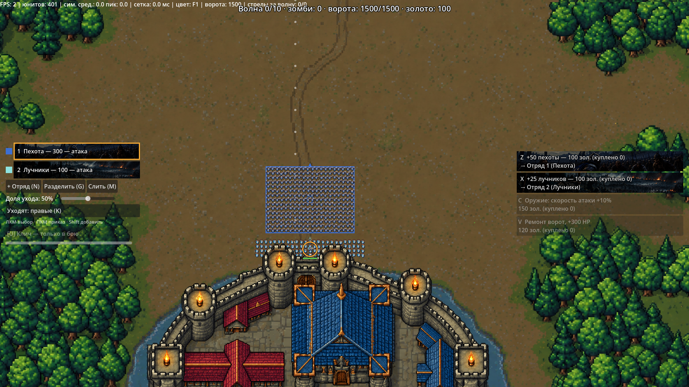
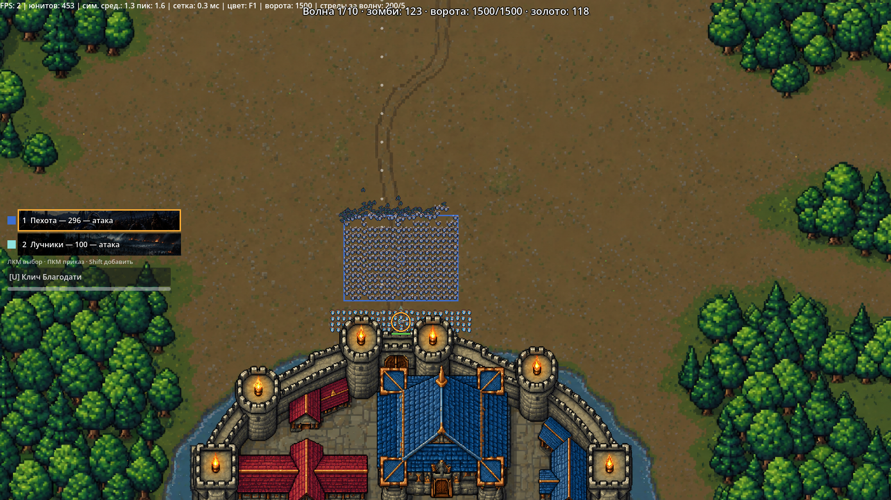

# Задача 17: финальные размеры кнопок

Симуляция не менялась:
- регрессия против эталона — бит в бит, эталон не обновлялся;
- regress_hero против main.gd до задачи (7989593) — бит в бит: 49 ударов, 56 добитых, без дерева и с кадрами эффектов.

## Итоговые размеры (data/ui_layout.json)

| поле | было | стало | на экране 1920×1080 (смоук) |
|---|---|---|---|
| shop_button_size | [448, 56] | **[464, 56]** | все кнопки магазина 464×56 |
| squad_button_size | [352, 48] | [352, 48] | 352×48 |
| action_button_height | 36 | 36 | 36 |
| war_cry_size | [300, 40] | **[352, 40]** | кнопка 352×40, полоса перезарядки 352×8 |

- **Полоса Клича.** До сих пор она тянулась на ширину панели отрядов (374 px), а не на ширину кнопки: так было и в задаче 16 (300 px только у кнопки). Теперь у полосы SIZE_SHRINK_BEGIN — ровно ширина Клича (352), высота 8 как была.
- **Значения по умолчанию в main.gd** (если файла нет) приведены к тем же числам. Тест сверяет их с файлом.

**Полосы иллюстраций.**
- Магазин пересоздан под 464×56: `art/ui/<тип>_928x112.png`. Из crop (0, 330, 1536×219) берётся середина 1536×185 (y 347).
- Копии под 448×56 (`_896x112`) удалены. В art/ui остались только `_928x112` и `_704x96`.
- Полосы отрядов `_704x96` пересоздал тем же генератором — они побайтно совпали с прежними, изменений в git нет.
- Градиент не трогал: 0.45 → 0.0 на 0.6 ширины.

## Кегль магазина: строки, которые пришлось менять

Проверил ширину всех строк магазина при кегле 16 в худшем случае: клавиша «Shift+Z», цена 9999, «макс.», куплено 99, «→ Отряд 8 (Пехота 4)». Места под текст в кнопке 464: 456 px у обычной кнопки, 446 px у кнопки с иллюстрацией.

| строка | ru | en | итог |
|---|---|---|---|
| пехота, лучники, копейщики (+ строка «→ Отряд …») | до 408 px | до 372 px | помещаются при 16, без изменений |
| «Оружие: скорость атаки +N% — цена (куплено N)» | 514 px | 486 px | **не помещается** |
| «Ремонт ворот, +N HP — цена (куплено N)» | 456 px | 421 px | на ru — впритык |

**Что изменено.** Перевод не сокращал. У «Оружия» и «Ворот» нет второй строки «→ Отряд…», поэтому цена и «куплено» уходят на вторую строку, как у пехоты и лучников:

```
C  Оружие: скорость атаки +10%          C  Weapons: attack speed +10%
150 зол. (куплено 0)                    150 gold (bought 0)
```

Новые ключи в data/translations.csv (переводы переимпортированы):

| ключ | ru | en |
|---|---|---|
| HUD_SHOP_ROW_TITLE | `%s  %s` | `%s  %s` |
| HUD_SHOP_ROW_PRICE | `%s (куплено %d)` | `%s (bought %d)` |

Прежний HUD_SHOP_ROW оставлен для пакетов юнитов. Ни одна существующая строка перевода не менялась.

Итог: все кнопки магазина на ru и en — кегль 16, в начале забега и после покупок (пехота и лучники до предела «макс.», «Оружие» и «Ворота» по 15 раз, цены до 1275).

## Тесты: без зашитых размеров

- **check_v65** читает размеры из data/ui_layout.json:
  - вместо «shop == [448, 56], Клич == [300, 40]» проверяет, что размеры — [w, h] больше 0 и что main берёт их из файла;
  - значения по умолчанию в main совпадают с файлом;
  - подгонка текста и вырезка полос — на размере из файла.
- **smoke_v65_art** сверяет с ui_layout:
  - кнопки ровно заданного размера;
  - кегль магазина не ниже кегля темы (16 — читается у новой кнопки, не зашит) на ru и en, в том числе после покупок;
  - полоса Клича шириной в кнопку;
  - 8 отрядов, действия и Клич на экране.
- Зашитых 448, 300 и 56 в тестах не осталось.

## Проверка

- **Полный run_all:** PASS, 59 шагов, 704 с.
  - Первый прогон упал на моей новой проверке полосы Клича: она нашла растяжку на 374 px, исправлено.
  - Второй прогон упал на smoke_v40 (мышь): «ПКМ по панели — цели отрядов изменились». Тест работает с настоящим курсором ОС. Отдельно он прошёл 3 раза из 3, в третьем полном прогоне — тоже. Считаю это нестабильностью теста, а не правкой. Если увидите его падение ещё раз — стоит разобрать отдельно.
- **FPS, волна 10 с героем** (view_v47 hero). «До» — 7989593 в новом временном worktree `%TEMP%\pr_wt17` (прежние pr_wt13 и pr_wt16 уже удалены). 4 пары поочерёдно:
  - до: 922.7 / 928.4 / 934.8 / 933.9 (среднее 930.0);
  - после: 929.1 / 929.6 / 918.7 / 957.0 (933.6);
  - разница — шум.

## Снимки (bench/report_17/, 1920×1080)

Передышка — магазин справа, отряды слева, кнопка Клича:



Бой, 5 с после начала волны 1 (магазин в бою скрыт), отряды и Клич:



Снимки делает скрипт `bench/shots_v67_ui.gd <папка>`; файлы данных он не меняет.

## Что проверить руками

- **Двухстрочные «Оружие» и «Ворота».** Теперь все четыре кнопки магазина в две строки, одной высоты 56. Посмотрите, не хочется ли и пакеты юнитов сделать по той же схеме: название, а под ним «цена (куплено) → Отряд».
- **Длинные клавиши.** Если переназначить покупку на длинную клавишу («Shift+Z» и т. п.), первая строка «Оружия» на ru — около 360 px, запас есть.
- **«Стена щитов».** Кнопка отряда с ней — кегль 15 (в 352 при 16 не влезает). Это кнопка отряда, требование «не ниже 16» относилось к магазину. Если и здесь нужно 16 — расширить squad_button_size или сократить «● Стена щитов».
- **Клич 352** теперь ровно по ширине кнопок отрядов.
- **Временный worktree** `%TEMP%\pr_wt17` удалить: `git worktree remove --force C:\Users\danil\AppData\Local\Temp\pr_wt17`.

## Незакоммиченное у вас

Ничего: перед задачей рабочая копия была чистой, после коммита незакоммиченных файлов нет.
