# Задача 18: универсальная кнопка и панель

Симуляция не менялась:
- регрессия против эталона — бит в бит, эталон не обновлялся;
- regress_hero против main.gd до задачи (7bfebcb) — бит в бит: 49 ударов, 56 добитых, без дерева и с кадрами эффектов.

## Этап A. Реальные файлы

Файлы лежали в `art/`, а не в `art/ui/`. Я перенёс их в `art/ui/` и закоммитил вместе с задачей.

| файл | ожидалось | на деле |
|---|---|---|
| `art/ui/ui_button_c6.png` | 160×128, 4 состояния по 160×32 | **160×32 — одно состояние** |
| `art/ui/ui_panel_c8.png` | не меньше 48×48 | 48×48 |

**Число состояний кнопки.** По заданию высоту состояния нужно считать как высоту/4. Для этого файла это 8 px, а это меньше двух углов (6+6), так что кадр нарезать нельзя. Картинка — одна полная рамка. Поэтому число состояний вынесено в `data/ui_theme.json`: `"states": 1`, а `state_rows` указывает строку для каждого состояния (сейчас везде 0). Пока наведение, нажатие и недоступность сделаны из одного кадра:

| состояние | рамка (`state_modulate`) | текст |
|---|---|---|
| обычная | как есть | `#c0cbdc` |
| наведение | как есть | `#feae34` |
| нажатая | затемнена до `#c0cbdc`, текст ниже на 2 px | `#feae34` |
| недоступная | затемнена до `#8b9bb4` | `#5a6988` |

Когда нарисуете 4 состояния столбиком, поставьте `"states": 4`, `state_rows` = 0/1/2/3, все `state_modulate` = `#ffffff` и перегенерируйте тему. Код править не нужно.

**Остальные проверки:**
- ширина чётная;
- полупрозрачных пикселей нет, только альфа 0 и 255;
- все цвета из Endesga 32: у кнопки `fee761`, `c0cbdc`, `3e2731`, у панели `b86f50`, `733e39`, `fee761`, `e4a672`;
- в каждом угловом квадрате есть непрозрачные пиксели.

**Найденный дефект: угол в имени на 1 пиксель меньше нарисованного.** Внутренняя жёлтая линия со скосом выходит на 1 пиксель арта за угол из имени:
- у панели скос занимает x/y 7–9, а угол c8 — это 0–7;
- у кнопки жёлтый пиксель скоса стоит в (6, 6), а угол c6 — это 0–5.

Из-за этого края 9-slice неоднородны: крайний пиксель края растягивается вместе с ним. На вкладке «Дары» (панель 1880 px) у каждого угла появлялись жёлтые пятна около 50×25 px и разрывы линии. Поэтому в `ui_theme.json` есть отдельное поле **`slice`**: у кнопки 7 (на экране 14), у панели 9 (на экране 18), а не 12 и 16 из задания. Угол из имени по-прежнему проверяется (имя и `corner` должны совпадать). От него считаются отступы текста.

Генератор проверяет однородность краёв и печатает наименьший рабочий срез. При срезе 6/8 он пишет FAIL с подсказкой «наименьший однородный срез 7/9». Если поправите арт под c6/c8, удалите `slice` из json.

## Этап B. Масштаб ×2 и тема

**`bench/make_ui_scaled.gd`** читает `data/ui_theme.json`: масштаб, файлы, угол, срез, число и строки состояний, отступы, цвета. Порядок запуска:

```
godot --headless --path . -s res://bench/make_ui_scaled.gd     # проверка арта, PNG ×2 в art/ui/x2/
godot --headless --path . --import                              # импорт новых PNG
godot --headless --path . -s res://bench/make_ui_scaled.gd     # тема art/ui/theme.tres
godot --headless --path . -s res://bench/make_ui_scaled.gd -- check   # только проверка (шаг run_all)
```

Как он работает:
- увеличивает PNG ближайшим соседом (`Image.INTERPOLATE_NEAREST`) и перезаписывает их, только если пиксели изменились;
- тему собирает, только когда импорт свежий: импортированная текстура совпадает с исходником ×2 пиксель в пиксель. Иначе просит запустить `--import`;
- у подресурсов темы постоянные id, поэтому повторная генерация даёт тот же файл байт в байт (проверено по md5).

**Почему готовые копии ×2, а не NinePatchRect или масштаб ноды.**
- StyleBoxTexture рисует текстуру 1:1 к холсту, и свойства масштаба у него нет. Увеличенная копия — единственный способ получить пиксель арта 2×2, не трогая раскладку.
- NinePatchRect — отдельный узел, а не стиль. Его пришлось бы подкладывать под каждую кнопку, вручную переключать по наведению и нажатию и синхронизировать размер. Темой он не задаётся.
- Масштаб ноды (`scale = 2`) увеличивает и текст, и область клика, а контейнеры о нём не знают: размеры, выравнивание и `get_global_rect` в тестах поедут.

**Как подключена тема.**
- `res://art/ui/theme.tres` подключена ко всему проекту через `gui/theme/custom` в project.godot.
- В ней **только вариации типов**: `FrameButton` (на базе Button), `FramePanel` (PanelContainer) и `FrameLabel` (Label, тёмный контур текста на светлой панели). Базовые Button, PanelContainer и Label тема не задаёт.
- Значит, на контрол, которому вариацию не назначили явно, тема не действует вообще. Исключения (магазин, отряды, карточки, любые свои StyleBox) защищены по построению, а не списком.
- Рамку назначают `UI.frame_button(b, menu)`, `UI.frame_panel(p)` и `UI.frame_label(l)` в `scripts/ui.gd`.
- Почему не тема на корневом контроле каждого экрана: в бою кнопки действий и Клич лежат в одной панели с кнопками отрядов. Тема на корне задела бы и их (цвет текста, контур). Пришлось бы раздавать темы по веткам, а меню паузы и настройки ещё и отдельно, это хрупко. Вариации надёжнее и проще.
- Тонкость Godot: вне дерева сцены контрол вариацию темы проекта не видит (`get_theme_stylebox` отдаёт встроенный стиль). Поэтому поля баннера при сборке берутся из темы напрямую (`UI.panel_margins()`).

**Button (`FrameButton`):**
- StyleBoxTexture на normal, hover, pressed (и hover_pressed), disabled; focus — пустой, фокус с клавиатуры виден цветом текста `#feae34`;
- `region_rect` указывает на строку состояния;
- срез 14, отступ текста слева и справа 20 (угол 6×2+8), сверху и снизу 6;
- тёмный контур текста `#181425`, толщина 6;
- кнопки меню не меньше 320×64 (`min_size` в json, хранится константами темы).

**Почему отступ сверху и снизу только 6, а не 20:** при высоте кнопки 48 отступы по 20 оставили бы 8 px на строку текста. Высота строки при кегле 16 — 22 px.

**Панель (`FramePanel`):** срез 18, отступы содержимого 24 (угол 8×2+8, больше среза).

## Этап C. Где применена тема

| экран | что |
|---|---|
| главное меню | «Играть», «Настройки», «Выход» — рамка, ≥ 320×64 (вышло 467×64, по ширине колонки) |
| настройки | «Назад», «Сбросить по умолчанию», кнопки клавиш (ширина 320 прежняя, высота по тексту). Вкладки, флажки, ползунки и подложка вкладок — стандартные |
| хаб | «Начать забег», «Дневник», «В меню», «Закрыть» — рамка. Вкладка «Дары» и дневник — на панели темы, «Купить» — рамка (высота по тексту, как строка дара). Вкладки и содержимое «Осады» стандартные |
| меню паузы | содержимое на панели темы (затемнение экрана прежнее), 4 кнопки — рамка |
| баннеры («Волна…», дневник, итог волны) | панель темы вместо StyleBoxFlat, ширина прежняя (700) |
| «Командир пал» | метка теперь на панели темы (`hero_fallen_panel`, видна вместе с меткой, клики пропускает) |
| итог забега | баннер на панели, «В хаб» — рамка ≥ 320×64 |
| бой | кнопки действий отряда (создать, разделить, слить) и Клич — рамка |

**Прозрачность баннера.** Панель арта непрозрачная. В первом прогоне run_all smoke_v41 честно поймал, что баннер в начале забега закрывает весь строй («видно 0 из 400 юнитов»). Раньше фон баннера был чёрным с альфой 0.55. Теперь рамке баннера и «Командир пал» задано `self_modulate.a = 0.55` (константа `BANNER_BG_ALPHA` возвращена). Это действует только на рамку, текст остаётся непрозрачным. Меню, хаб и дневник непрозрачные, как и были.

**Изменения макета.** Кегли не менялись. Вместо этого:
- **Кнопки действий 36 → 48, Клич 352×40 → 352×48** (`data/ui_layout.json` и значения по умолчанию в main.gd). При высоте 36 углы не налезают (14+14 = 28 ≤ 36), и строка технически помещается. Но от тёмной середины рамки оставалась полоска 8 px, и текст лежал на светлом бордюре. При 48 середина 24 px, текст внутри неё. Полоса перезарядки Клича прежняя: 352×8.
- **Панель отрядов шире: 374 → 408 px.** Три кнопки действий с отступами 20 не помещаются в 374. С магазином справа и полем не пересекается.
- Панель «Даров» помещается: 1884×905 при экране 1080.

**Что не тронуто (тема на это не действует):**
- кнопки магазина, кнопки отрядов, карточки выбора;
- кнопка «Уходят: …» (деление), вкладки, флажки, ползунки, HUD-метки, метка «ПАУЗА», сигнал всплеска.

**Проверка «выглядят как до»:** те же снимки сделаны на 7bfebcb (временный worktree) и после правок. Сравнивал попиксельно по прямоугольникам самих кнопок:
- кнопки отрядов, 3 из 4 кнопок магазина и одна карточка — 0 отличающихся пикселей;
- «Оружие» — 4 пикселя, две карточки — 12 и 9 пикселей. Все они в полупрозрачных местах, где просвечивает поле боя: фон между двумя прогонами отличается по всему кадру.

## Этап D. Тесты и проверка

**Поиск кнопок.**
- Смоуки нажимают кнопки по узлам: `get_global_rect().get_center()` у `play_button`, `action_buttons[k]`, `squad_buttons[k]` и т. д.
- По фиксированным точкам кликают только по полю боя (smoke_v40 и check_v40: протяжка, рамка, приказы). Это мировые координаты, а не кнопки, так задумано.
- Переписывать не пришлось. Размеры в новых тестах читаются из `ui_theme.json` и `ui_layout.json`.

**Новое и изменённое в тестах:**
- `bench/check_v68_ui.gd` (шаг run_all «рамки: тема и где применена»):
  - тема проекта подключена, в ней только 3 вариации;
  - копии ×2 совпадают с исходником ближайшим соседом;
  - срез, `region_rect`, отступы и цвета совпадают с json;
  - рамка есть на всех перечисленных экранах, кнопки меню не меньше `min_size`;
  - у кнопок действий и Клича высота из `ui_layout`, углы не налезают, строка помещается;
  - магазин, отряды, карточки и «деление» без вариации и без рамки;
  - баннер прежней ширины и полупрозрачный;
  - панели «Даров», паузы и итога целиком на экране.
- Шаг run_all «рамки: арт и срез 9-slice» — `make_ui_scaled.gd -- check`.
- `check_v45`: вместо «золотые кнопки» проверяется рамка темы.

**Итоги проверок:**
- **Полный run_all:** PASS, 61 шаг, 692 с. Первый прогон упал на smoke_v41 (баннер закрывал строй, см. выше), после исправления — PASS.
- **Регрессия против эталона и regress_hero** — бит в бит.
- **FPS, волна 10 с героем** (view_v47 hero). «До» — 7bfebcb в новом worktree `%TEMP%\pr_wt18`, 4 пары поочерёдно:
  - до: 941.9 / 937.0 / 904.3 / 914.2 (среднее 924.4);
  - после: 927.1 / 906.0 / 908.6 / 905.9 (среднее 911.9);
  - −1.3%. Это в пределах разброса между прогонами (904–942), считаю шумом. Тема рисуется только у HUD-кнопок, в бою это 4 StyleBoxTexture.

## Снимки (bench/report_18/, 1920×1080)

Делает их `bench/shots_v68_ui.gd <папка>`. Файлы данных он не меняет и печатает прямоугольники кнопок для сравнения «до» и «после».

Главное меню:

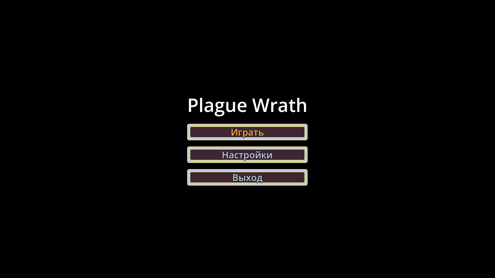

Настройки (видео и управление):

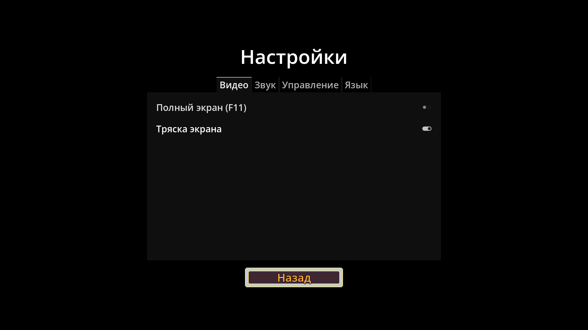
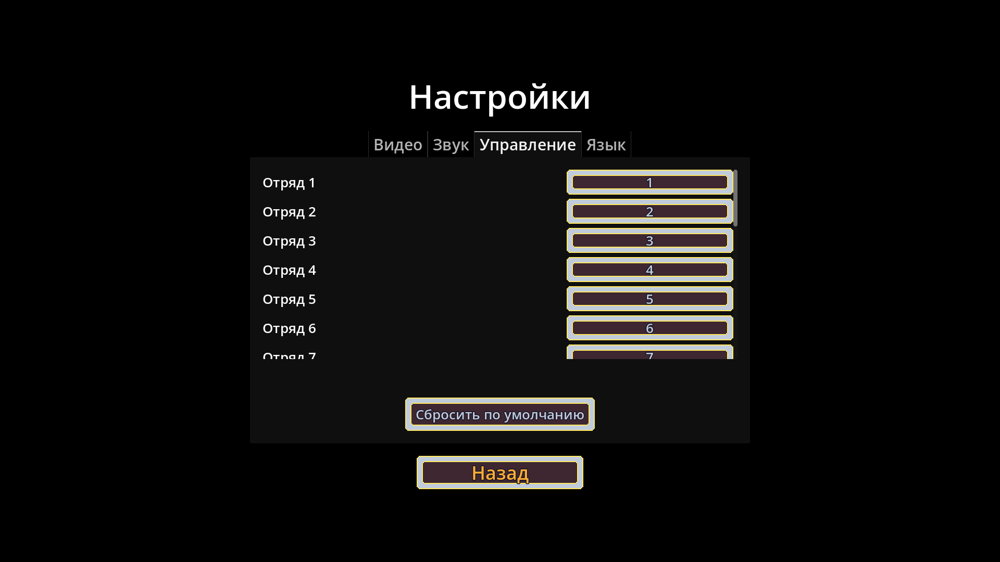

Хаб: «Осада», «Дары», дневник:

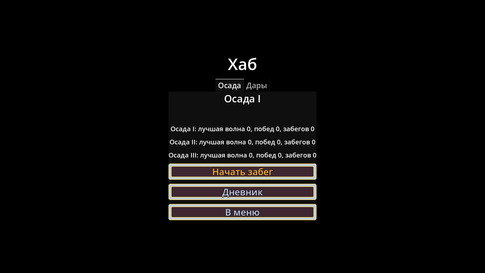
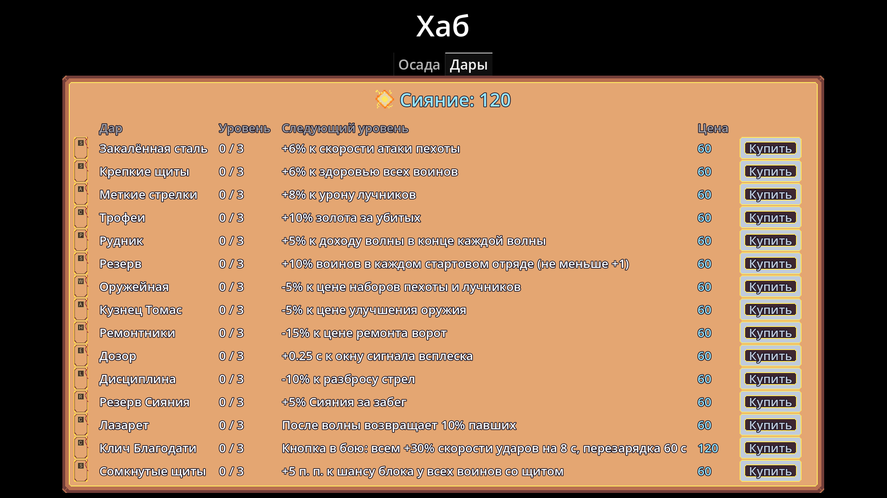
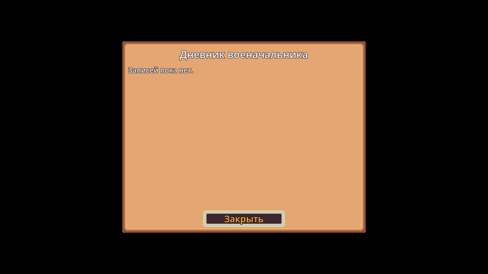

Баннер в начале забега (строй виден сквозь рамку) и итог волны:

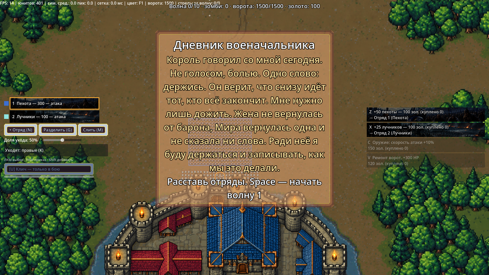
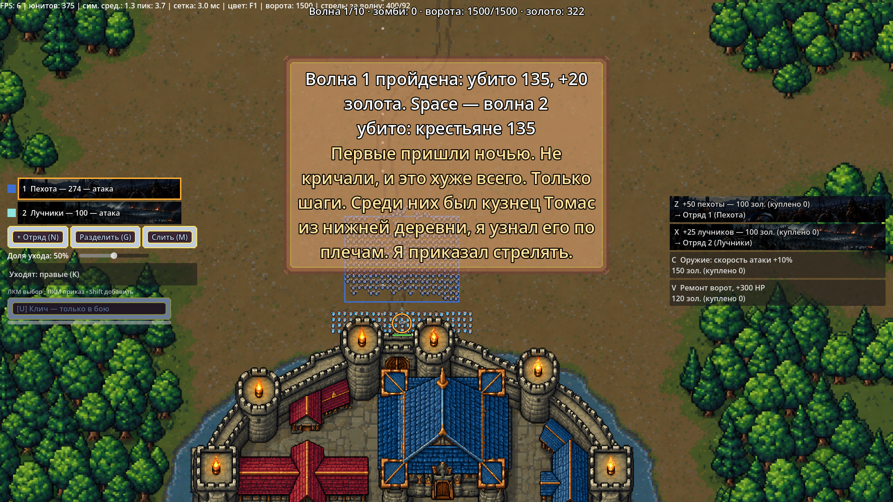

Передышка: кнопки действий 48 и Клич; карточки выбора без изменений:

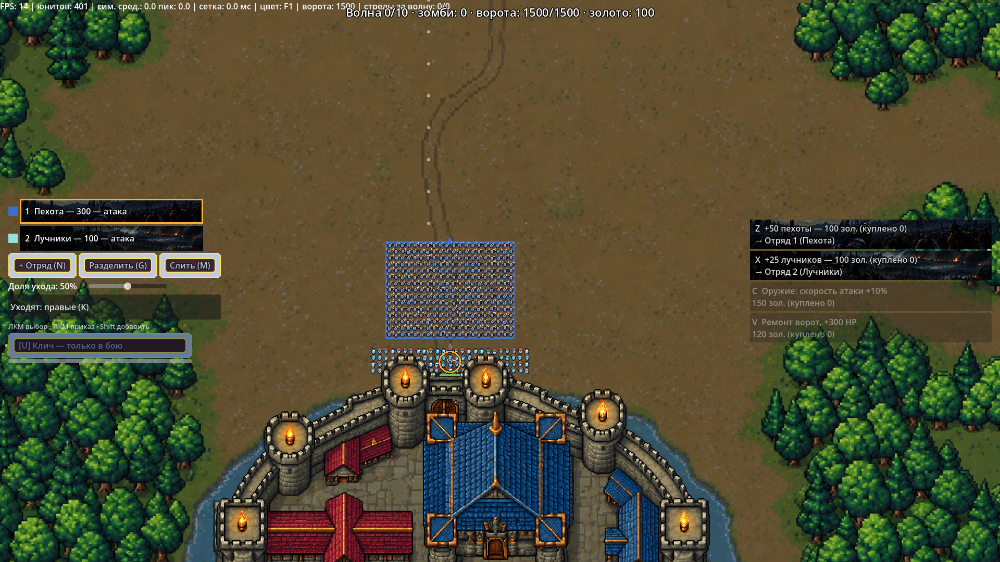
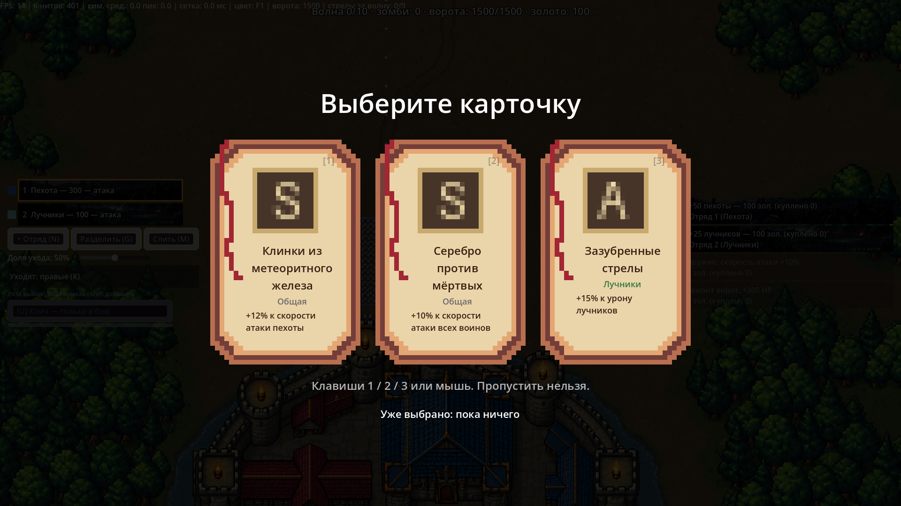

Бой: «Командир пал», Клич; меню паузы:

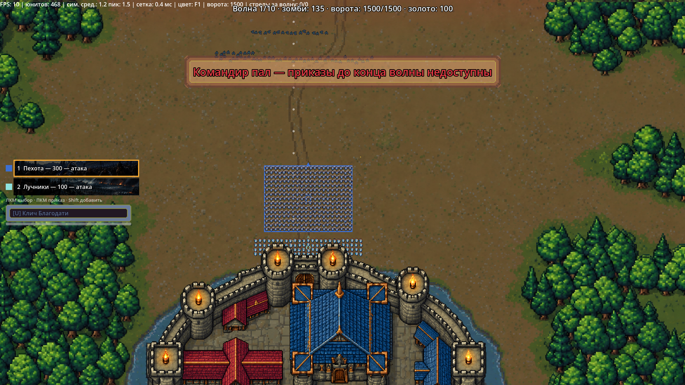
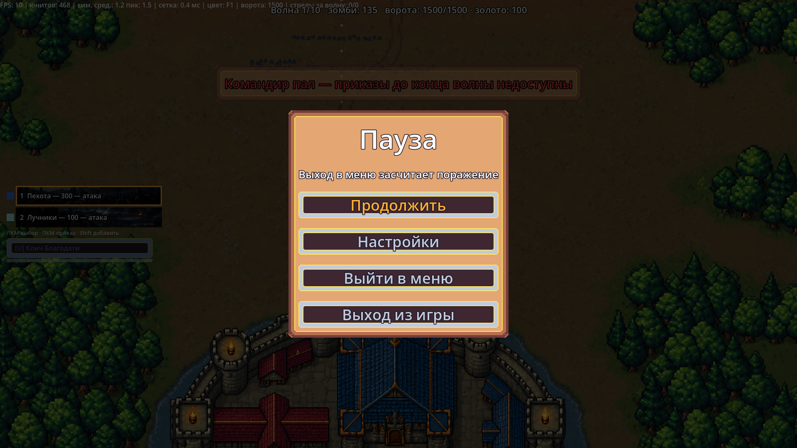

Итог забега:

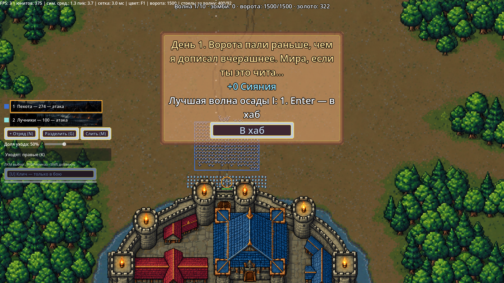

## Что проверить руками

- **Четыре состояния кнопки.** Сейчас состояния сделаны цветом текста и затемнением одного кадра. Когда нарисуете их, достаточно правки json и перегенерации.
- **Угол c6/c8 против нарисованного 7/9.** Либо подвиньте скос внутренней линии внутрь угла, либо переименуйте файлы в `_c7` и `_c9` (тогда `corner` = `slice` и отступы текста пересчитаются от нового угла).
- **Высота кнопок действий 48 и Клича 48.** Если нужно ниже, лучше отдельная низкая рамка (например 160×24), чем сжатие этой: у неё бордюр 6 px арта с каждой стороны.
- **Светлая панель и белый текст.** Подписи на панелях (дары, дневник, пауза) с тёмным контуром `#181425` толщиной 6. Посмотрите, хватает ли контраста, особенно у полупрозрачной шапки таблицы даров и голубого «Сияния».
- **Прозрачность 0.55 у баннера** — как был старый чёрный фон. Плотнее: `BANNER_BG_ALPHA` в main.gd.
- **Пиксельная рамка при другом размере окна.** У кнопок и панелей стоит `texture_filter = nearest`. Он наследуется и текстом внутри, при 1920×1080 разницы нет. Посмотрите в оконном режиме другого размера.
- **Временные worktree:** `%TEMP%\pr_wt18`, а также оставшийся с прошлого раза `pr_wt17`. Удалить:
  - `git worktree remove --force C:\Users\danil\AppData\Local\Temp\pr_wt18`
  - `git worktree remove --force C:\Users\danil\AppData\Local\Temp\pr_wt17`

## Незакоммиченное у вас

`bench/shots_v67_ui.gd.uid` — был неотслеживаемым до задачи, не трогал.
