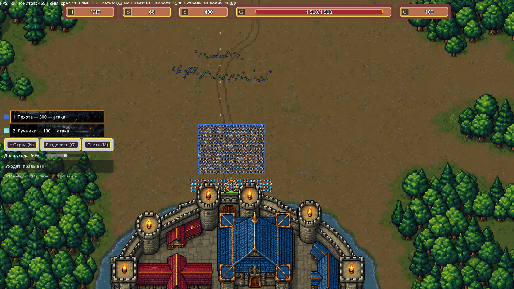
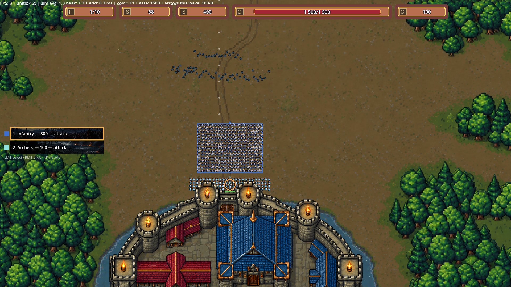
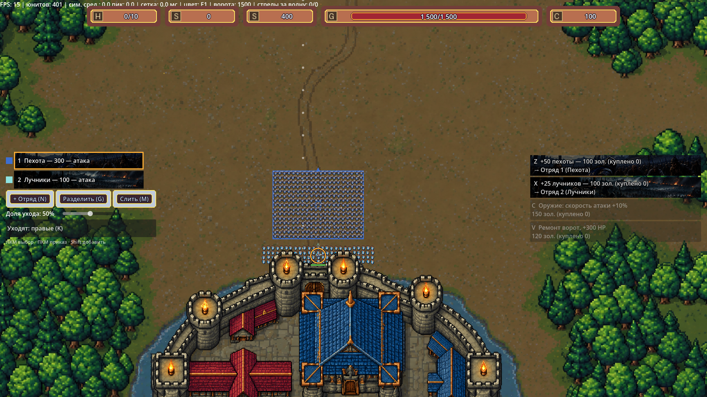
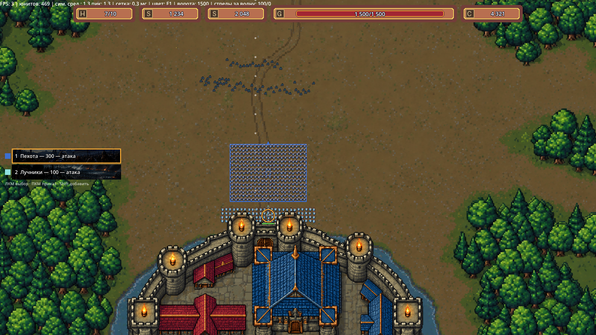
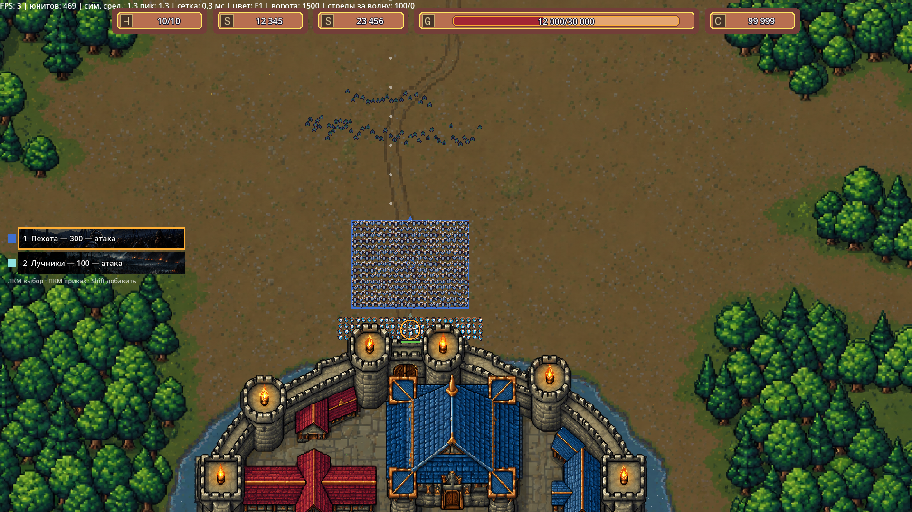
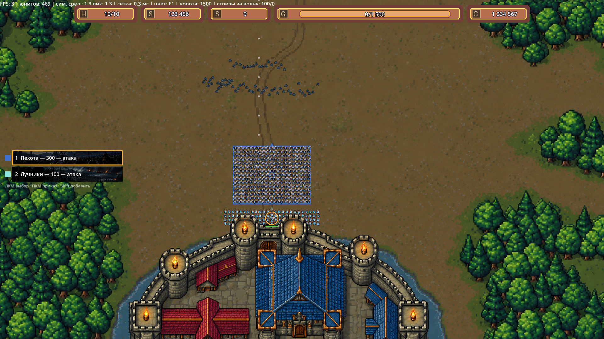
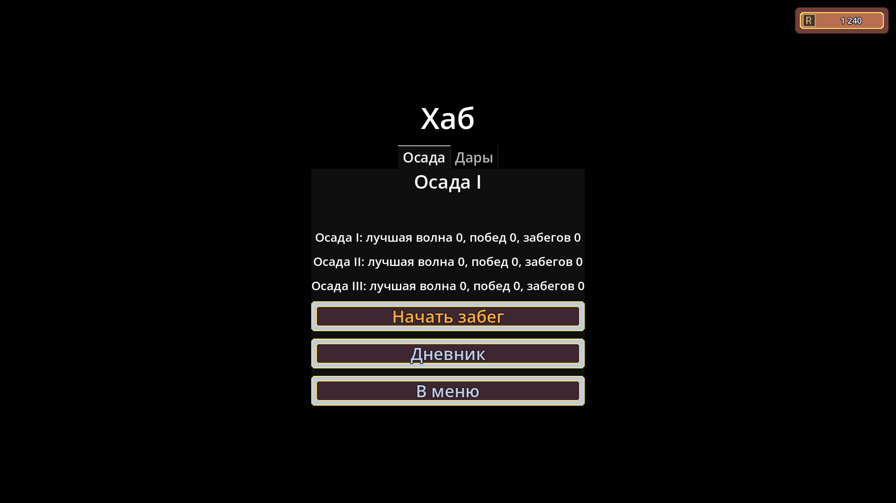
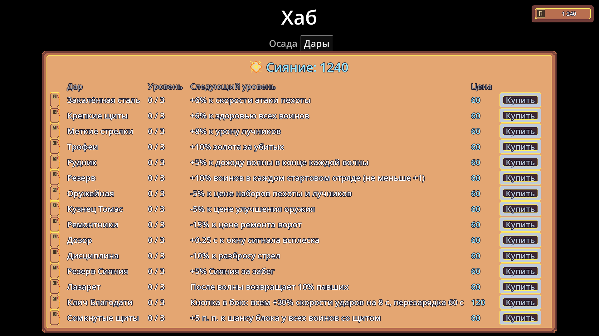
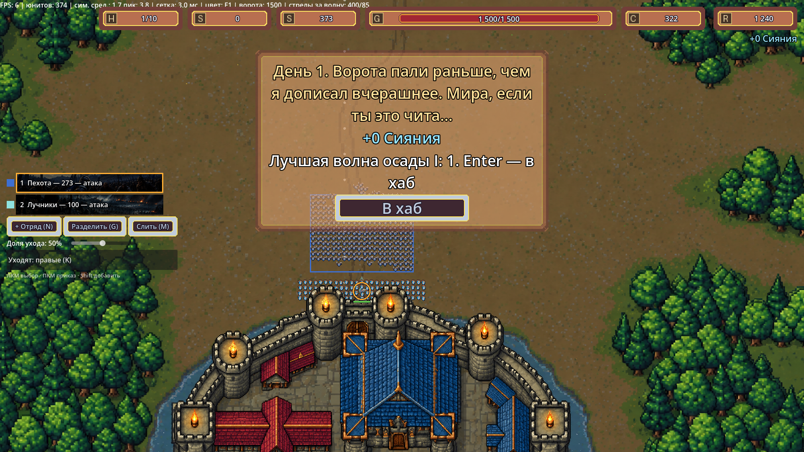
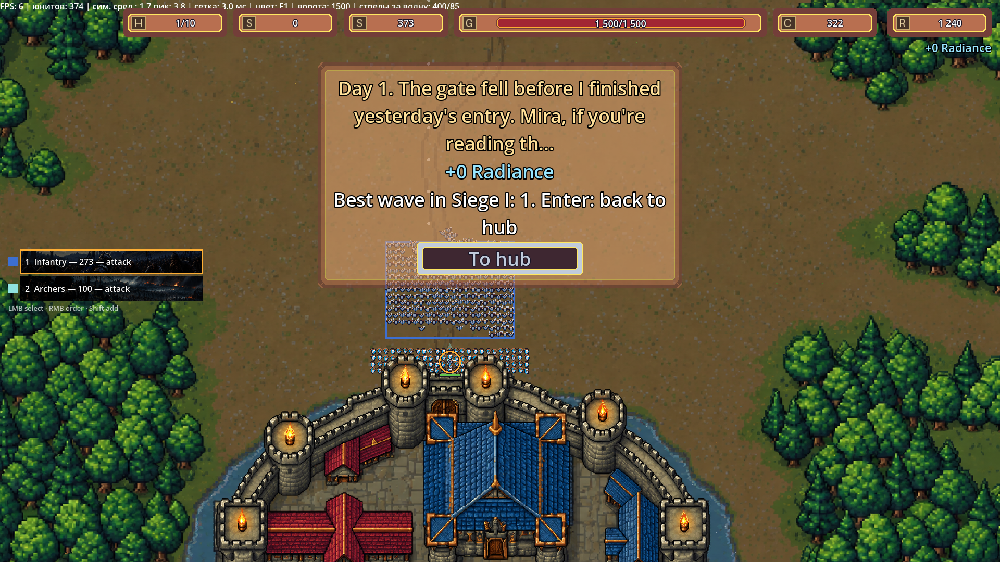

# Задача 19: верхняя панель боя из пяти окошек

Вместо строки hud_label вверху по центру стоит ряд из пяти окошек: Волна, Зомби, Войска, Ворота (полоса HP с числом поверх), Золото.
В хабе и на экране итога справа сверху — окошко «Сияние» того же вида. Симуляция не изменилась: регрессия против эталона и
regress_hero — бит в бит.

## Итоги проверок

- **run_all:** PASS, 62 шага (добавлен «верхняя панель боя и окошко Сияния (v69)»), 912 с. Первый прогон дал один FAIL —
  smoke_v40 (мышь, пункт «б»): ПКМ по строке панели отрядов дошёл до карты, мышь ОС в тот момент стояла на (3504, 923), то есть
  на втором мониторе. Отдельно smoke_v40 прошёл 4 раза из 4, повторный полный run_all — PASS. Считаю сбоем окружения, но см.
  «что проверить руками».
- **Регрессия против эталона** (шаг run_all) — провалов 0. **regress_hero** против main.gd из 8fc822d (до задачи) — бит в бит:
  1800 тиков, 49 ударов, 56 убито героем, с кадрами эффектов.
- **FPS, волна 10 с героем** (view_v47 hero). «До» — 8fc822d во временном worktree `%TEMP%\pr_wt18` (переключён с 7bfebcb),
  4 пары поочерёдно:
  - до: 826.3 / 874.2 / 876.7 / 843.3 (среднее 855.1, медиана кадра 1.06 мс);
  - после: 826.0 / 837.8 / 802.9 / 827.2 (среднее 823.5, медиана кадра 1.12 мс);
  - −3.7%, около +0.06 мс на кадр. Это больше разброса прошлых задач: вместо одной надписи теперь 5 рамок, 5 иконок, полоса
    из двух текстур и 5 подписей с контуром. При бюджете 16.7 мс на кадр это незаметно, но цифру не выдаю за шум.

## Этап A: файлы и тема окошка

Реальные размеры (проверка `bench/make_ui_scaled.gd -- check`, альфа только 0 и 255, все цвета из Endesga 32):

| Файл | Ожидалось | На деле | На экране (×2) |
|---|---|---|---|
| art/ui/ui_slot_c6.png | 100×28, угол 6 | 100×28 | 200×56 |
| art/ui/ui_bar_frame.png | 240×12, прозрачное окно | 240×12, **окна нет** | 480×24 |
| art/ui/ui_bar_fill.png | — | 240×12 | 480×24 |
| art/icons.png | есть | **файла нет** | — |

Расхождения и что сделано:
- **Фаска окошка шире угла 6.** Внутренняя жёлтая линия скругляется до 8-го пикселя (как у кнопки и панели в задаче 18).
  При срезе 6 растянутые края дали бы пятна, наименьший однородный срез — 8. Поэтому в `data/ui_theme.json` у `slot`
  задан `"slice": 8` (на экране 16). Поля содержимого считаются от угла 6: 6×2+2 = 14 слева и справа, 6×2 = 12 сверху и снизу.
  Внутри остаётся ровно 32 px по высоте — столько, сколько иконка ×2.
- **У рамки полосы нет прозрачного окна.** Внутри она залита светлым #e4a672 (это «пустая» полоса), а заливка — та же картинка
  с красным #a22633 внутри. Поэтому порядок обратный: снизу рамка, поверх — заливка, обрезанная по доле HP. Генератор
  проверяет, что вне окна заливки (`fill_left` = 2, `fill_right` = 2 пикселя арта, то есть x 2..238) рамка и заливка
  совпадают пиксель в пиксель: краёв-ступенек при обрезке нет.
- **art/icons.png нет** (ни в рабочей папке, ни в git), коммитить нечего. Иконки берутся из заглушки `art/icons_placeholder.png`
  (рамка с буквой: H, S, S, G, C, R). Когда положите атлас, иконки подхватятся сами, порядок ячеек — `data/icon_atlas.json`.

Механизм тот же, что в задаче 18: `bench/make_ui_scaled.gd` по `data/ui_theme.json` проверяет арт, делает копии ×2 ближайшим
соседом в `art/ui/x2/` и собирает тему. В теме добавились вариации `FrameSlot` (StyleBoxTexture окошка) и `FrameBar` (иконки
`frame` и `fill`, константы окна заливки и шага). Базовые типы по-прежнему не заданы.

Заливка полосы не масштабируется. Она лежит целиком (480×24) внутри Control с `clip_contents`, меняется только ширина
обрезки: `fill_left + floor(доля × окно / 2) × 2` — по целым пикселям арта. При HP 0 ширина 0, полоса пустая.

## Этап B: панель

- **`scripts/hud_slot.gd`** — окошко: рамка, иконка, число; с `bar` — полоса и число поверх неё.
  `set_value(v, max)` ничего не делает, если число то же. Подпись и ширина обрезки меняются только при новом значении.
- **`scripts/top_hud.gd`** — ряд окошек. Из `data/ui_layout.json`, раздел `top_hud`, берутся:
  - отступ сверху 16, зазор 12, высота 56;
  - масштаб иконок 2, зазор иконка–число 8;
  - кегль 18, минимум 16;
  - список `slots`: id, иконка по имени из `icon_atlas.json`, ширина, `bar`.

  Раз в 0.1 с `update()` спрашивает у main.gd значение каждого окошка (`_hud_value(id)` → `Vector2i(число, максимум)`, без строк).
- **Шестое окошко** — ещё одна запись в `slots`. Готовые id: `wave`, `zombies`, `zombies_left`, `troops`, `gate`, `gold`, `kills`.
  Тест добавляет `kills` через свою копию раскладки: панель строит 6 окошек без правки кода. Новый вид значения требует одной
  строки в `_hud_value`.
- **`get_values()`** возвращает словарь id → число, плюс `wave_max` и `gate_max`. Тесты читают его вместо текста.

Содержимое:
- **Волна** «N/M» (без лимита забега — «N»).
- **Зомби** — живые на поле (`zombie_alive`), как в задании. Старая строка показывала живых **плюс ещё не вышедших**
  (`zombie_alive + wave_remaining`). Если нужно прежнее значение — в `ui_layout.json` поставить `"id": "zombies_left"`.
- **Войска** — сумма `squad_n` по занятым отрядам игрока. Это те же числа, что в строках панели отрядов («Пехота — 300»).
  Герой не в отряде (`unit_squad = -1`), в `squad_n` не входит и не считается. Купленные в передышке юниты входят, как и в
  панели. В начале забега 400 = 300 + 100.
- **Ворота** — полоса и «текущее/максимум» (`ceil(max(gate_hp, 0))` / `round(gate_hp_max)`). Разрушены — «0/…», полоса пустая.
- **Золото** — `floor(gold)`.

Числа от 1000 — с пробелом между тысячами (`12 345`). Подгонка такая: кегль 18; если не помещается — вниз до 16; если и так
не помещается — сокращение «12.3к» / «12.3k» (ключ `HUD_THOUSANDS`). Что получилось на 1920×1080:
- место под число в окошке 200 px: 200 − 28 (поля) − 32 (иконка) − 8 = **132 px**;
- «99 999» при 18 занимает **63 px**; даже «1 234 567» — 88 px; «12 000/30 000» на полосе 480 px — 126 px;
- уменьшение кегля и сокращение при текущей раскладке не срабатывают. Тест проверяет их искусственно узким местом:
  60 px → «12 345» кеглем 17, «100 000» → кегль 16 и «100.0к».

«Не создавать строки зря» применено не только к панели:
- подпись Клича пересобирается при смене состояния или показываемого числа (было каждые 0.1 с);
- строки панели отрядов — при смене числа, приказа, навыка, типа или номера (было каждые 0.25 с);
- при смене языка или клавиш всё сбрасывается и пересобирается.

Не тронуто:
- подписи кнопок действий (сравнение строк раз в 0.25 с);
- магазин — он только в передышке.

### Что было в hud_label и куда ушло

| Было в hud_label | Куда |
|---|---|
| «Волна N/M · зомби: Z · ворота: H/M · золото: G» | пять окошек панели |
| Разведка в передышке: «Дальше: волна N · ↑ 150 · ← 60 (бегуны 20, рыцари 4)» | `info_label` слева сверху под панелью (x 16, y 84, ширина 560, перенос по словам), без рамки |
| Сообщения `_say` на 3 с: отказ команды («Поставь паузу (Space)», «Свободных отрядов нет…»), итог карточки «Жертва ради победы: …» | туда же, `info_label` |

Служебное было не в hud_label, а рядом, и осталось по прежним правилам:
- **FPS-строка** (`fps_label`, слева вверху) не изменилась. Она заходит под левые окошки на ~6 px (панель рисуется поверх).
- **Подсказка мыши** — в панели отрядов, как была.

`info_label` пересобирает текст только при смене строки разведки, номера волны или сообщения. Строку разведки и сообщения
теперь видно слева под панелью, а не по центру — так они не попадают на баннер (баннер начинается с x 610).

Положение. Ряд 1448×56 по центру, y 16..72 — на 1920×1080 это x 236..1684. Под панель сдвинуты:
- список выбранных карточек справа: y 8 → 84;
- строка всплеска: y 72 → 76;
- «ПАУЗА»: 112 → 116.

Баннер (120), «Командир пал» (156), отряды и магазин — без изменений. Тест проверяет, что панель не пересекается с отрядами,
магазином, карточками, разведкой, Кличем, всплеском, «ПАУЗА» и «Командир пал» и целиком на экране. Растяжение `canvas_items`
с аспектом keep: при любом окне 16:9 логический экран — 1920×1080, панель всегда помещается.

Сам hud_label и его создание удалены. Тесты, что читали текст, переведены на `get_values()`:
- `check_v41`, `smoke_v41`, `smoke_v51` — волна и ворота;
- `smoke_v39` — «ПАУЗА» под панелью;
- `smoke_v51_cardhud` — строка «Жертвы» в `info_label`.

Ключ `HUD_STATUS` остался в translations.csv: им пользуется эталон `bench/ref/main_ref.gd`.

## Этап C: Сияние

`TOP_HUD.corner_slot()` — то же окошко по записи `corner_slot` в `ui_layout.json`: иконка radiance, ширина 200,
отступы 16 сверху и справа.
- **Хаб:** справа сверху (x 1704..1904, y 16..72) на обеих вкладках, обновляется при покупке дара и смене языка. Вкладки, дары и
  дневник не сдвигались, тест проверяет, что окошко их не задевает. Крупная надпись «Сияние: N» на вкладке «Дары» осталась
  как была (на неё опираются check_v44 и check_v45).
- **Экран итога:** окошко с балансом после забега. Под ним «+N Сияния» — заработанное за забег, оно уже было в тексте баннера;
  в баннере строка тоже осталась. Список карточек справа уходит ниже «+N».
- **В бою** окошка нет, тест это проверяет.

## Этап D: тесты и снимки

- **`bench/check_v69_hud.gd`** (без окна, шаг run_all). Проверяет:
  - тему окошка и полосы против `ui_theme.json`, копии ×2 пиксель в пиксель;
  - формат чисел, сокращение ru/en, подгонку кегля;
  - обрезку заливки: 100% → 476 px, 40% → 192, 0 HP → 0, 1 HP → 4; картинка заливки всегда 480×24;
  - шестое окошко данными;
  - раскладку и размеры из `ui_layout.json` (ничего не зашито: 200, 600, 56, 12, 16 читаются из файла);
  - соответствие значений состоянию боя;
  - что подписи не пересобираются без изменений;
  - Сияние в хабе и на итоге.
- `check_v68_ui`: в списке вариаций темы добавлены FrameSlot и FrameBar.
- `make_ui_scaled.gd -- check` (шаг run_all) теперь проверяет и окошко, и полосу.

Снимки 1920×1080 делает `bench/shots_v69_hud.gd <папка>`. Большие числа и доли ворот подставляются подменой источника
значений панели — симуляция не трогается.

Бой, малые числа (ru и en):

Передышка:

4 цифры, ворота 100%:

5 цифр, ворота 40% (ru и en):

6–7 цифр, ворота 0% (полоса пустая):

Хаб («Осада» и «Дары»):

Экран итога (ru и en). Ворота здесь целые: в сцене снимков поражение вызвано вручную после волны.

## Что проверить руками

1. **Иконки** — сейчас буквы из заглушки. Положить `art/icons.png` и посмотреть окошки.
2. **«Зомби»** — живые на поле или «живые + ещё не вышедшие», как было. Переключается одной правкой id в `ui_layout.json`.
3. **FPS-строка** заходит под левые окошки на ~6 px. Если мешает, её можно сдвинуть, но по заданию отладочное не трогал.
4. **Читаемость.** Белый текст 18 с тёмным контуром на светло-коричневом окошке. Число поверх красной и светлой части полосы.
5. **Хаб, вкладка «Дары»:** баланс виден дважды — в окошке и в крупной надписи. Если надпись лишняя, её можно убрать
   (поправив check_v44 и check_v45).
6. **smoke_v40** упал один раз из шести запусков: ПКМ по строке отряда, курсор ОС на втором мониторе. Стоит прогнать при
   одном мониторе.
7. Временные worktree: `%TEMP%\pr_wt17` и `%TEMP%\pr_wt18` (сейчас на 8fc822d). Удалить:
   `git worktree remove --force %TEMP%\pr_wt17` и то же для `pr_wt18`.
