# Задача 20: варианты шрифта — снимки 1920×1080

Сделаны `bench/shots_v70_fonts.gd -- --font=<вариант> <папка>`. Вариант по умолчанию — `font_variant` в `data/ui_theme.json` (сейчас default).
Подробности — в `bench/overnight_report_20.md`.

## ru

| Экран | default | fusion12 | fusion10 |
|---|---|---|---|
| Главное меню | [default](default_ru_menu.png) | [fusion12](fusion12_ru_menu.png) | [fusion10](fusion10_ru_menu.png) |
| Хаб, «Дары» | [default](default_ru_hub_gifts.png) | [fusion12](fusion12_ru_hub_gifts.png) | [fusion10](fusion10_ru_hub_gifts.png) |
| Хаб, «Дары» с причинами отказа | [default](default_ru_hub_gifts_locked.png) | [fusion12](fusion12_ru_hub_gifts_locked.png) | [fusion10](fusion10_ru_hub_gifts_locked.png) |
| Передышка: магазин и отряды | [default](default_ru_respite.png) | [fusion12](fusion12_ru_respite.png) | [fusion10](fusion10_ru_respite.png) |
| Бой: верхняя панель | [default](default_ru_battle.png) | [fusion12](fusion12_ru_battle.png) | [fusion10](fusion10_ru_battle.png) |
| Выбор карточки | [default](default_ru_cards.png) | [fusion12](fusion12_ru_cards.png) | [fusion10](fusion10_ru_cards.png) |

## en

| Экран | default | fusion12 | fusion10 |
|---|---|---|---|
| Главное меню | [default](default_en_menu.png) | [fusion12](fusion12_en_menu.png) | [fusion10](fusion10_en_menu.png) |
| Хаб, «Дары» | [default](default_en_hub_gifts.png) | [fusion12](fusion12_en_hub_gifts.png) | [fusion10](fusion10_en_hub_gifts.png) |
| Хаб, «Дары» с причинами отказа | [default](default_en_hub_gifts_locked.png) | [fusion12](fusion12_en_hub_gifts_locked.png) | [fusion10](fusion10_en_hub_gifts_locked.png) |
| Передышка: магазин и отряды | [default](default_en_respite.png) | [fusion12](fusion12_en_respite.png) | [fusion10](fusion10_en_respite.png) |
| Бой: верхняя панель | [default](default_en_battle.png) | [fusion12](fusion12_en_battle.png) | [fusion10](fusion10_en_battle.png) |
| Выбор карточки | [default](default_en_cards.png) | [fusion12](fusion12_en_cards.png) | [fusion10](fusion10_en_cards.png) |

## Превью (ru)

### Главное меню

default:

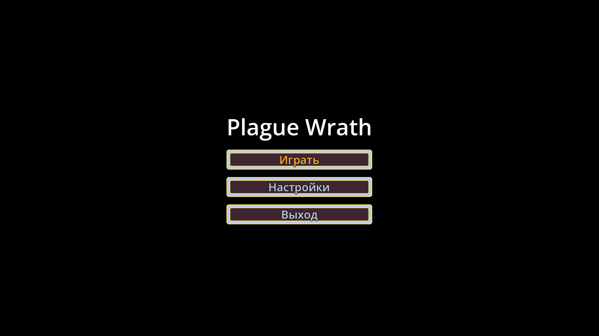

fusion12:

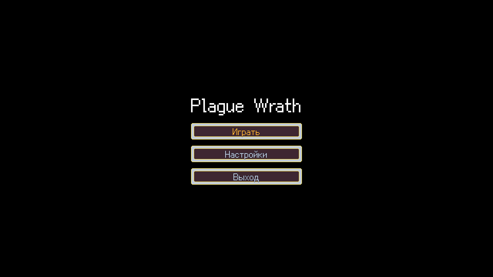

fusion10:

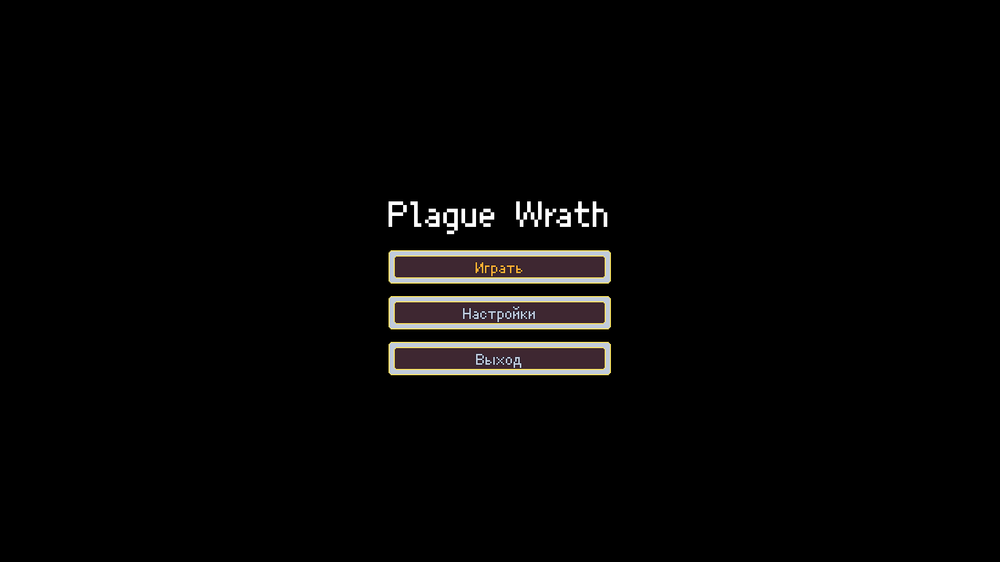

### Хаб, «Дары»

default:

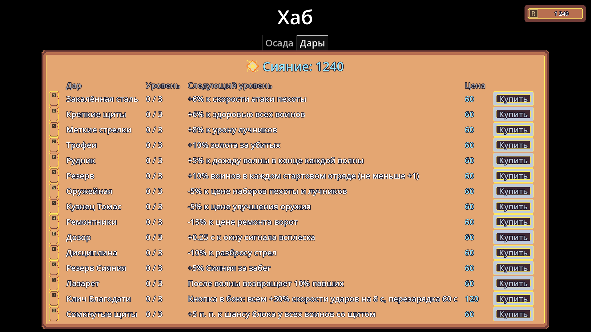

fusion12:

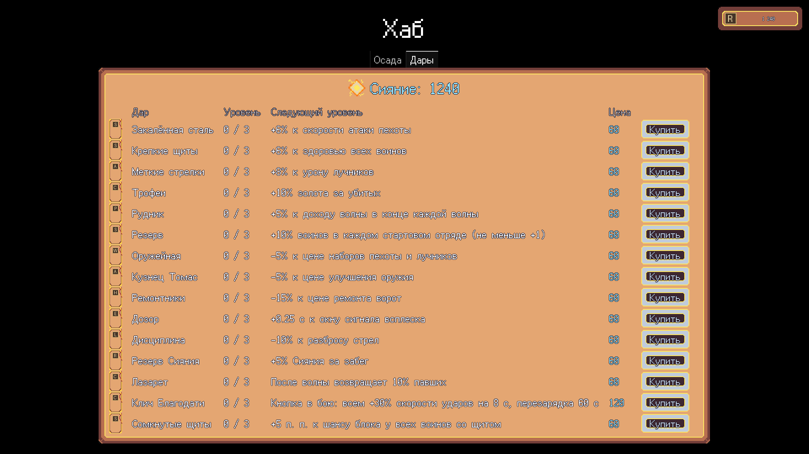

fusion10:

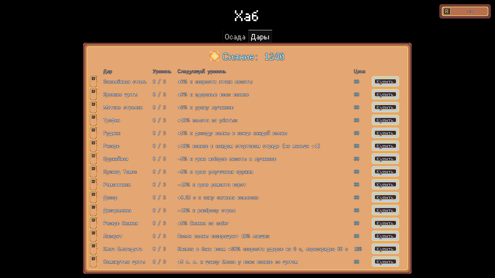

### Хаб, «Дары» с причинами отказа

default:

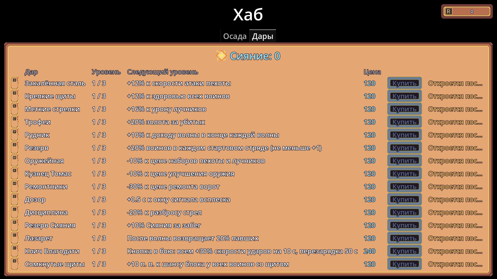

fusion12:

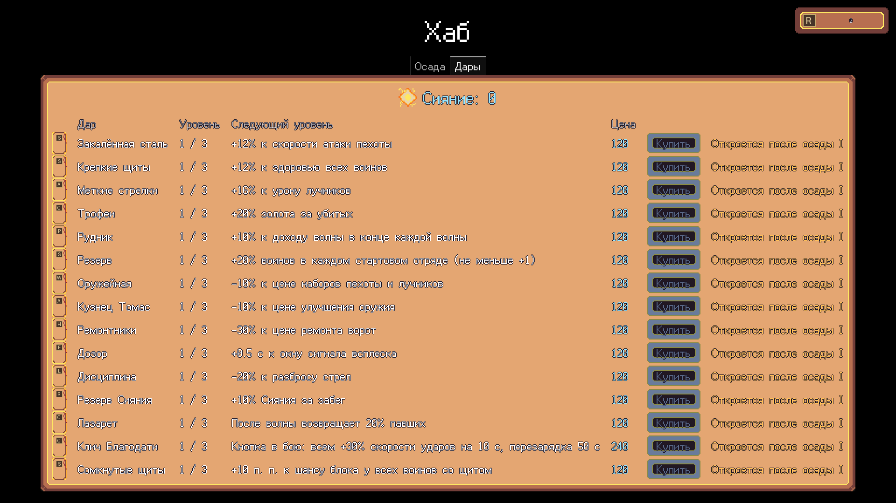

fusion10:

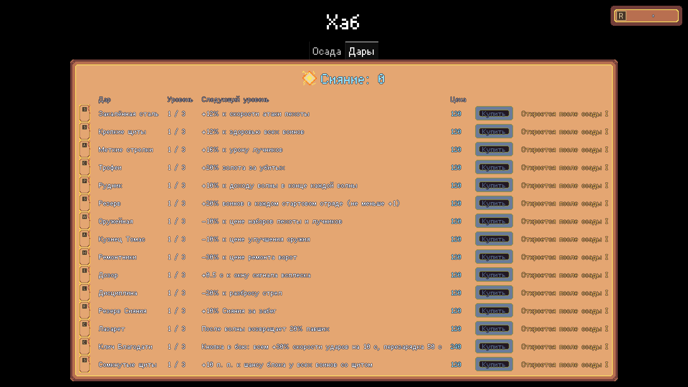

### Передышка: магазин и отряды

default:

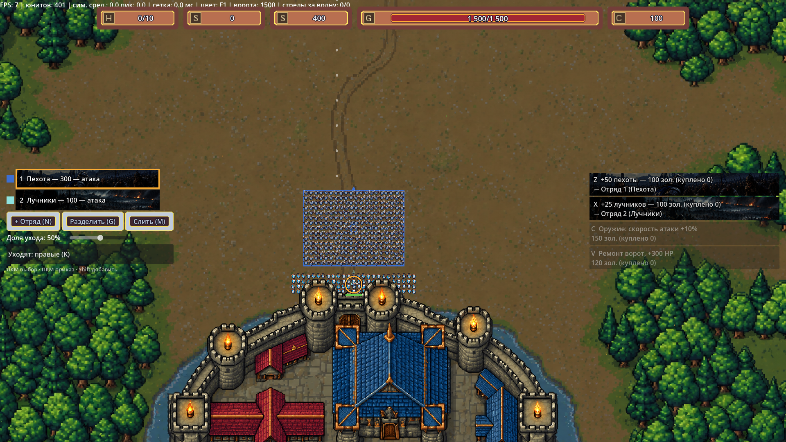

fusion12:

fusion10:

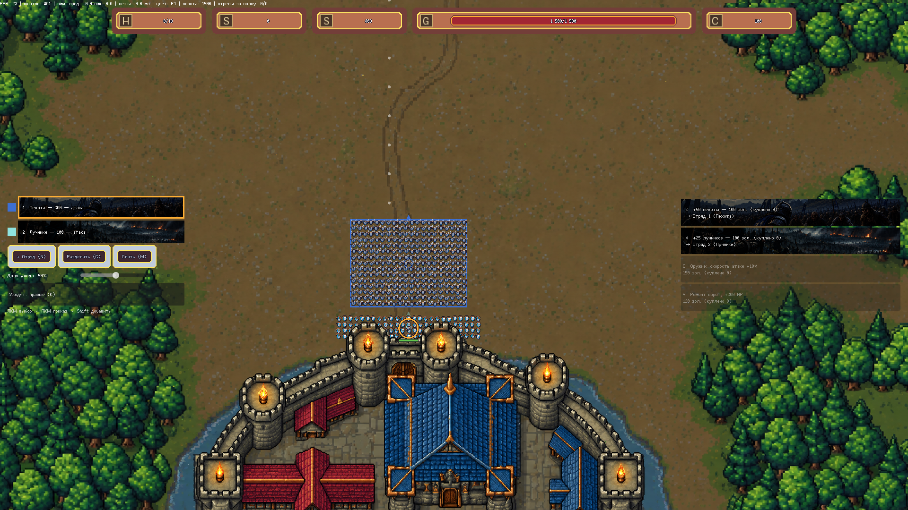

### Бой: верхняя панель

default:

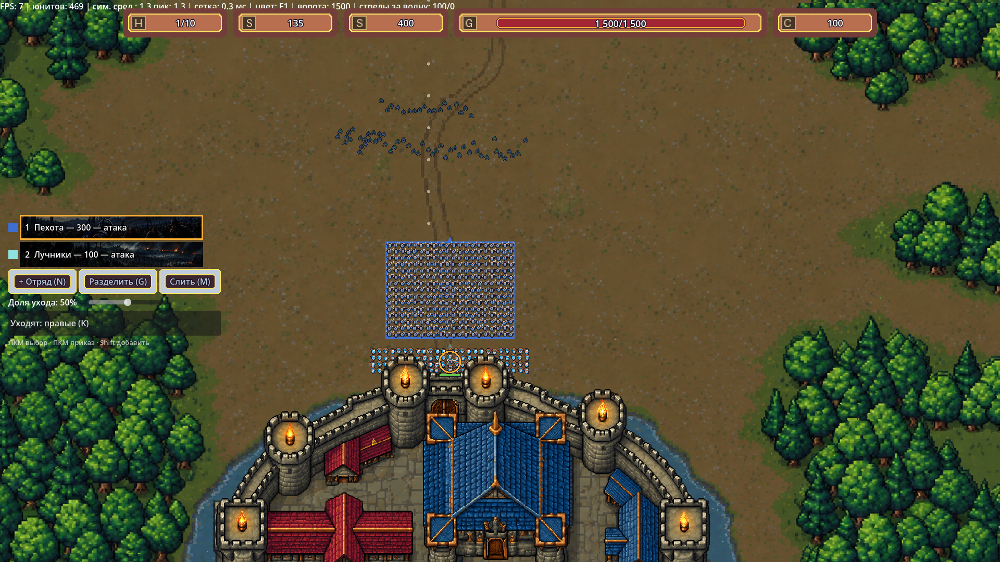

fusion12:

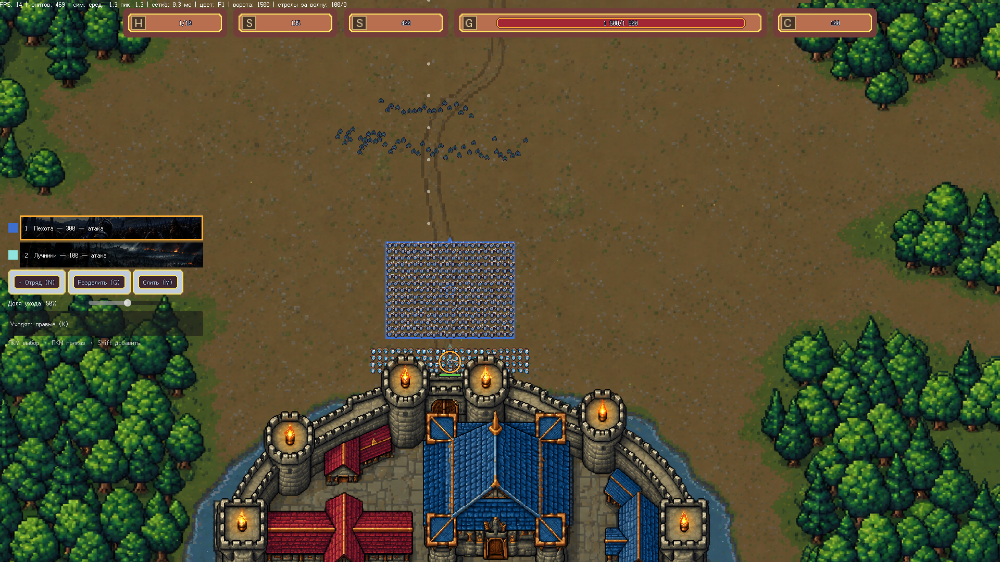

fusion10:

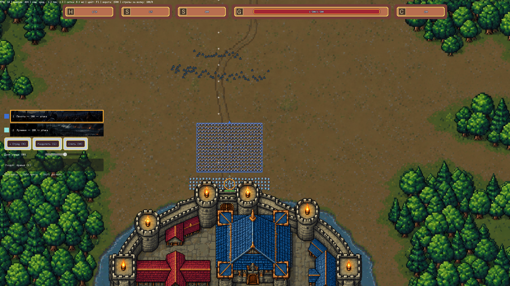

### Выбор карточки

default:

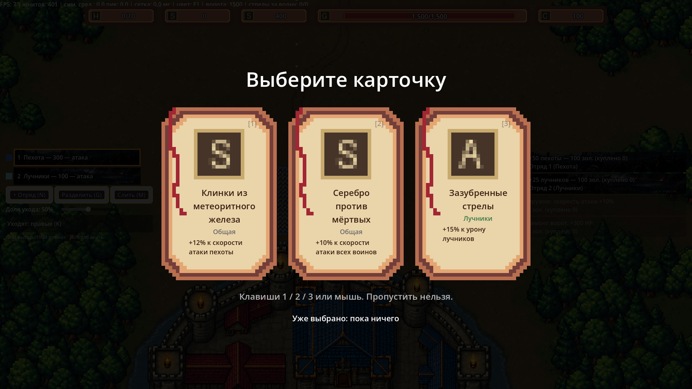

fusion12:

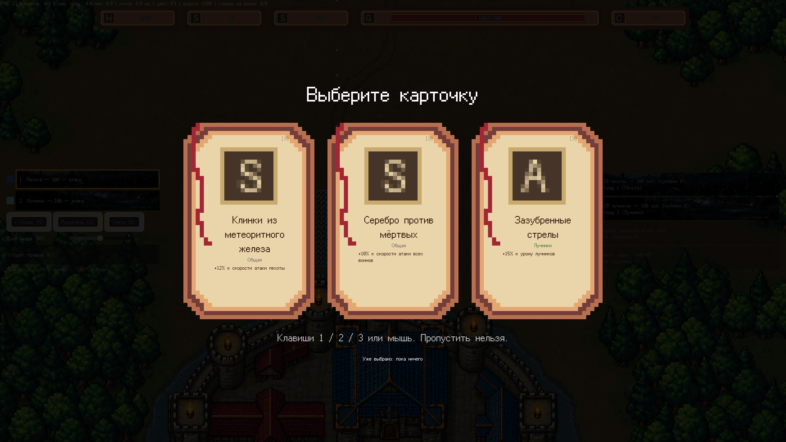

fusion10:

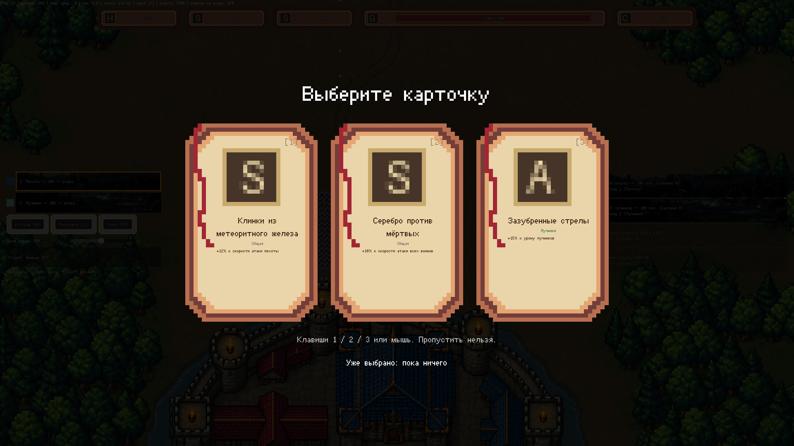
