# Задача 21: правило кеглей пиксельного шрифта — снимки 1920×1080

Правило: кегль — родной × k, k ≥ 2 (`fonts.min_scale`), ближайший к заданному, при равной разнице больший (`fonts.rounding`: nearest).
Сделаны `bench/shots_v70_fonts.gd -- --font=<вариант> <папка>`. Вариант default не изменился — его снимки в [report_20](../report_20/index.md)
(меню паузы там не снималось). Подробности и что не помещается — в `bench/overnight_report_21.md`.

## ru

| Экран | default | fusion12 | fusion10 |
|---|---|---|---|
| Главное меню | [default](../report_20/default_ru_menu.png) | [fusion12](fusion12_ru_menu.png) | [fusion10](fusion10_ru_menu.png) |
| Хаб, «Дары» | [default](../report_20/default_ru_hub_gifts.png) | [fusion12](fusion12_ru_hub_gifts.png) | [fusion10](fusion10_ru_hub_gifts.png) |
| Хаб, «Дары» с причинами отказа | [default](../report_20/default_ru_hub_gifts_locked.png) | [fusion12](fusion12_ru_hub_gifts_locked.png) | [fusion10](fusion10_ru_hub_gifts_locked.png) |
| Передышка: магазин и отряды | [default](../report_20/default_ru_respite.png) | [fusion12](fusion12_ru_respite.png) | [fusion10](fusion10_ru_respite.png) |
| Выбор карточки | [default](../report_20/default_ru_cards.png) | [fusion12](fusion12_ru_cards.png) | [fusion10](fusion10_ru_cards.png) |
| Бой: верхняя панель | [default](../report_20/default_ru_battle.png) | [fusion12](fusion12_ru_battle.png) | [fusion10](fusion10_ru_battle.png) |
| Меню паузы | — | [fusion12](fusion12_ru_pause.png) | [fusion10](fusion10_ru_pause.png) |

## en

| Экран | default | fusion12 | fusion10 |
|---|---|---|---|
| Главное меню | [default](../report_20/default_en_menu.png) | [fusion12](fusion12_en_menu.png) | [fusion10](fusion10_en_menu.png) |
| Хаб, «Дары» | [default](../report_20/default_en_hub_gifts.png) | [fusion12](fusion12_en_hub_gifts.png) | [fusion10](fusion10_en_hub_gifts.png) |
| Хаб, «Дары» с причинами отказа | [default](../report_20/default_en_hub_gifts_locked.png) | [fusion12](fusion12_en_hub_gifts_locked.png) | [fusion10](fusion10_en_hub_gifts_locked.png) |
| Передышка: магазин и отряды | [default](../report_20/default_en_respite.png) | [fusion12](fusion12_en_respite.png) | [fusion10](fusion10_en_respite.png) |
| Выбор карточки | [default](../report_20/default_en_cards.png) | [fusion12](fusion12_en_cards.png) | [fusion10](fusion10_en_cards.png) |
| Бой: верхняя панель | [default](../report_20/default_en_battle.png) | [fusion12](fusion12_en_battle.png) | [fusion10](fusion10_en_battle.png) |
| Меню паузы | — | [fusion12](fusion12_en_pause.png) | [fusion10](fusion10_en_pause.png) |

## Превью (ru)

### Главное меню

fusion12:

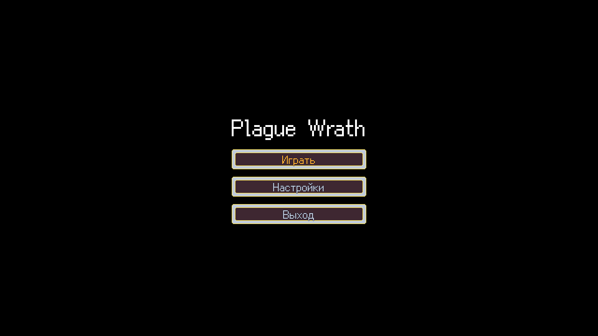

fusion10:

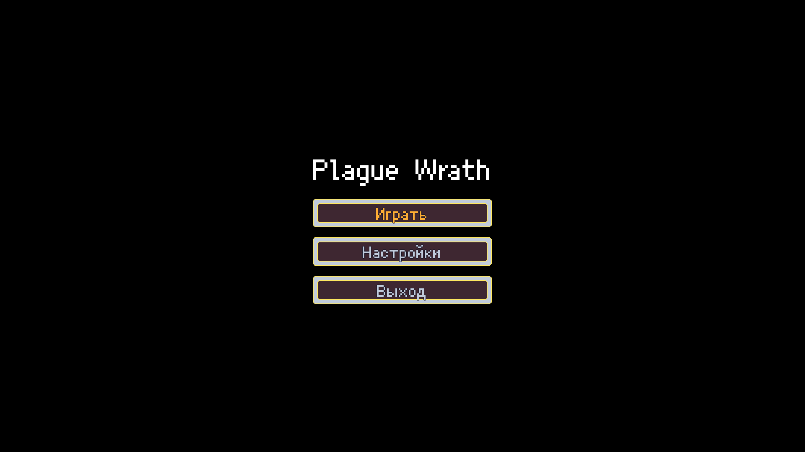

### Хаб, «Дары»

fusion12:

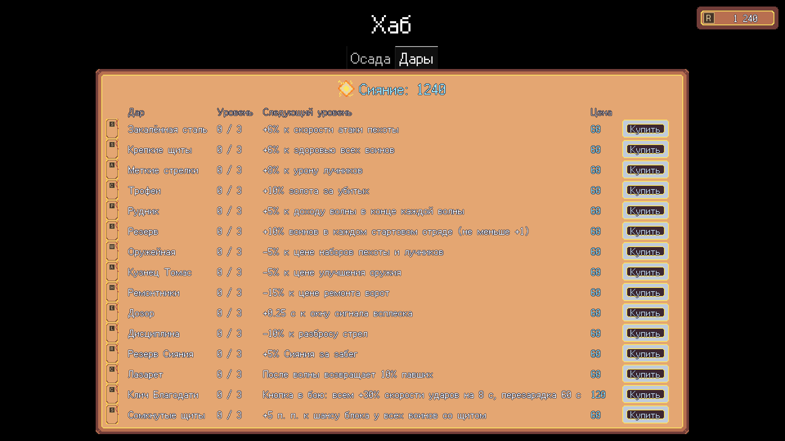

fusion10:

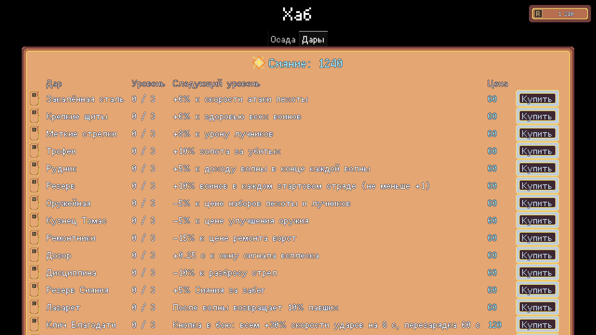

### Хаб, «Дары» с причинами отказа

fusion12:

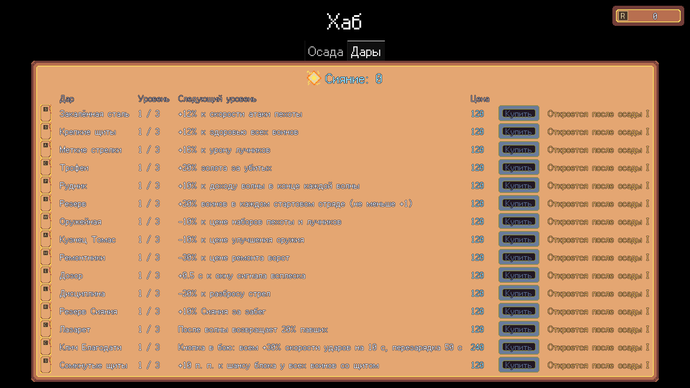

fusion10:

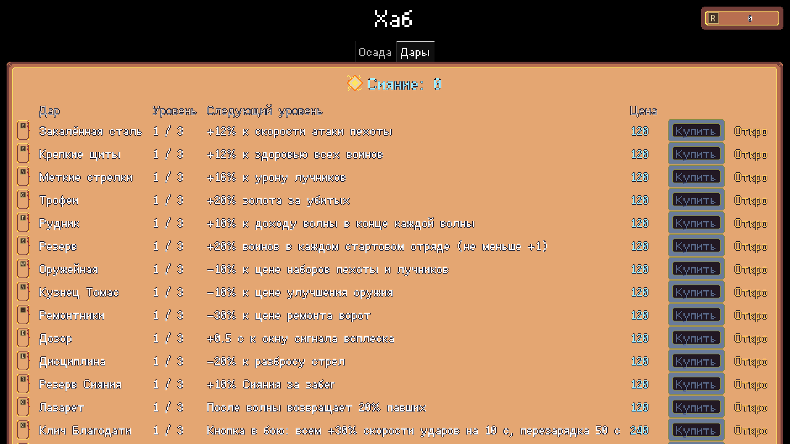

### Передышка: магазин и отряды

fusion12:

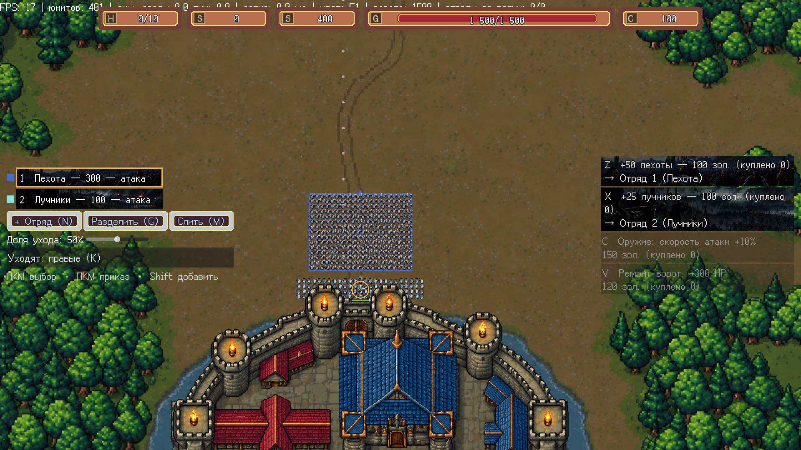

fusion10:

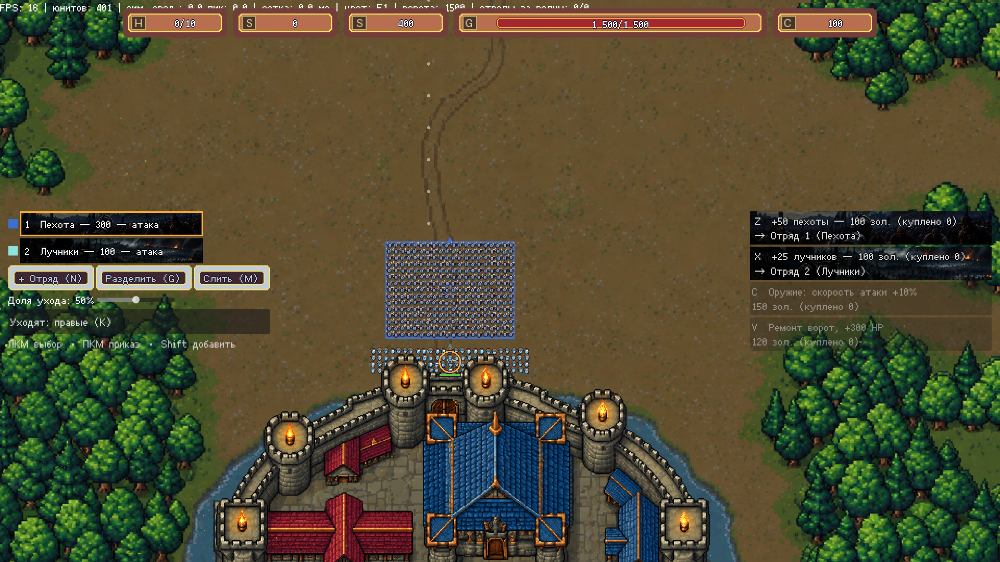

### Выбор карточки

fusion12:

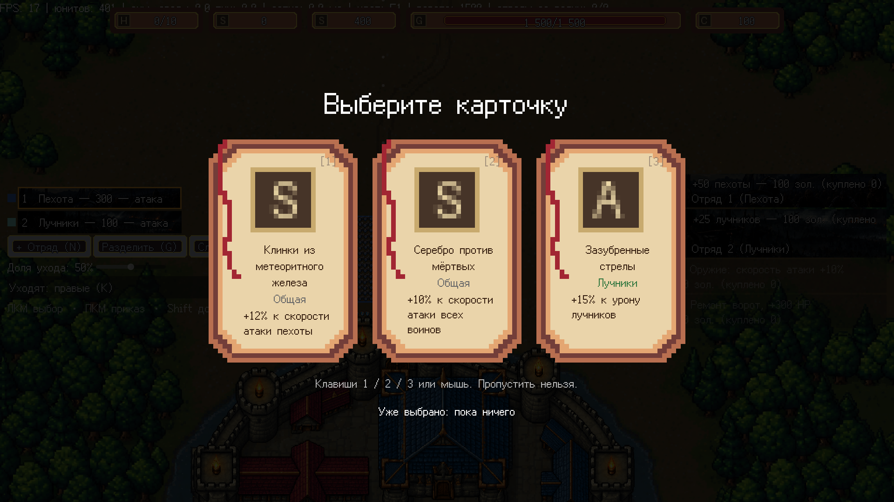

fusion10:

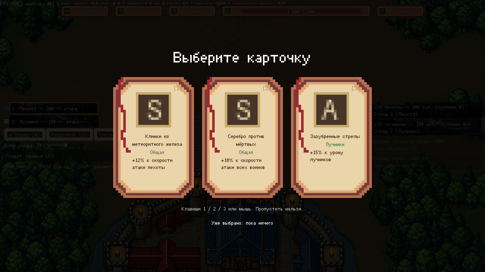

### Бой: верхняя панель

fusion12:

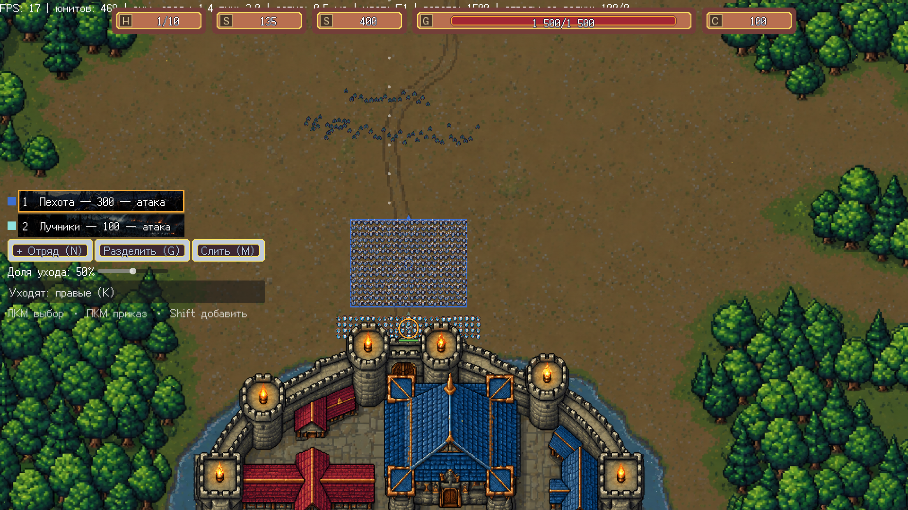

fusion10:

### Меню паузы

fusion12:

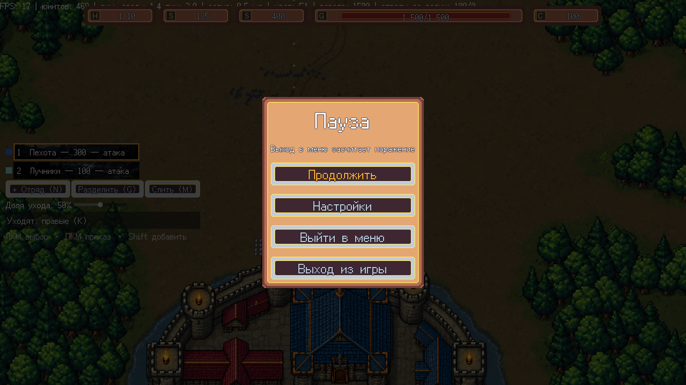

fusion10:

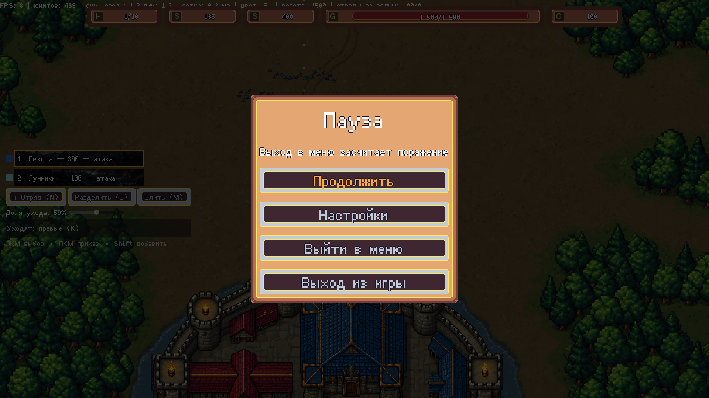
