# Задача 22: fusion10 по умолчанию, итоговые размеры — снимки 1920×1080

Шрифт по умолчанию — Fusion Pixel 10px (`font_variant` в `data/ui_theme.json`). Сделаны `bench/shots_v72_ui.gd <папка>`;
скрипт печатает `CLIP|...` для любого текста за границей своего места или экрана — в этом прогоне 0. Подробности — `bench/overnight_report_22.md`.

| Экран | ru | en |
|---|---|---|
| Передышка: магазин, отряды, кнопки действий, Клич | [ru](ru_respite.png) | [en](en_respite.png) |
| Передышка с баннером дневника | [ru](ru_banner_respite.png) | [en](en_banner_respite.png) |
| Бой: верхняя панель | [ru](ru_battle.png) | [en](en_battle.png) |
| Хаб, «Дары» | [ru](ru_hub_gifts.png) | [en](en_hub_gifts.png) |
| Хаб, «Дары» с причинами отказа | [ru](ru_hub_gifts_locked.png) | [en](en_hub_gifts_locked.png) |
| Хаб, дневник | [ru](ru_hub_diary.png) | [en](en_hub_diary.png) |
| Хаб, «Осада» | [ru](ru_hub_siege.png) | [en](en_hub_siege.png) |
| Главное меню | [ru](ru_menu.png) | [en](en_menu.png) |
| Настройки: видео | [ru](ru_settings_0.png) | [en](en_settings_0.png) |
| Настройки: звук | [ru](ru_settings_1.png) | [en](en_settings_1.png) |
| Настройки: управление | [ru](ru_settings_2.png) | [en](en_settings_2.png) |
| Меню паузы | [ru](ru_pause.png) | [en](en_pause.png) |
| Выбор карточки | [ru](ru_cards.png) | [en](en_cards.png) |
| Баннер конца волны | [ru](ru_banner_wave_cleared.png) | [en](en_banner_wave_cleared.png) |
| Экран итога | [ru](ru_result.png) | [en](en_result.png) |

## Превью (ru)

### Передышка: магазин, отряды, кнопки действий, Клич

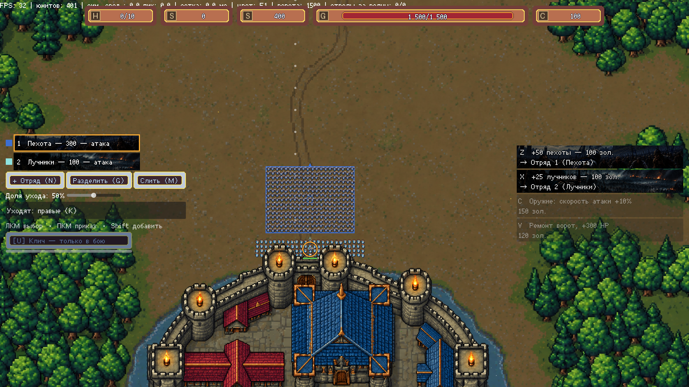

### Передышка с баннером дневника

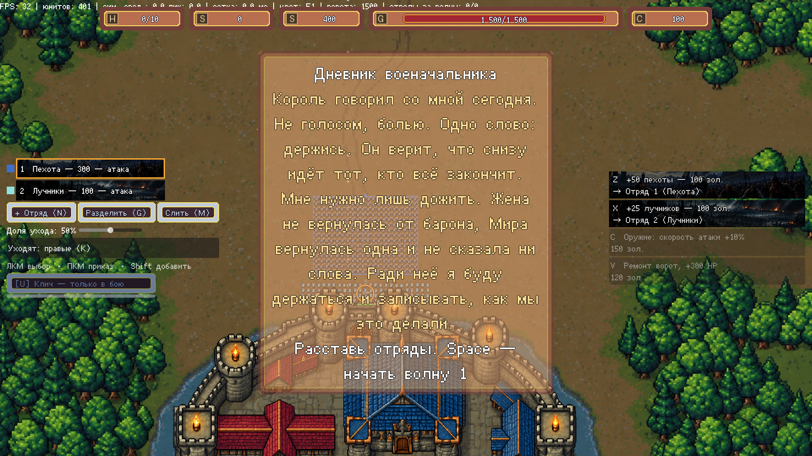

### Бой: верхняя панель

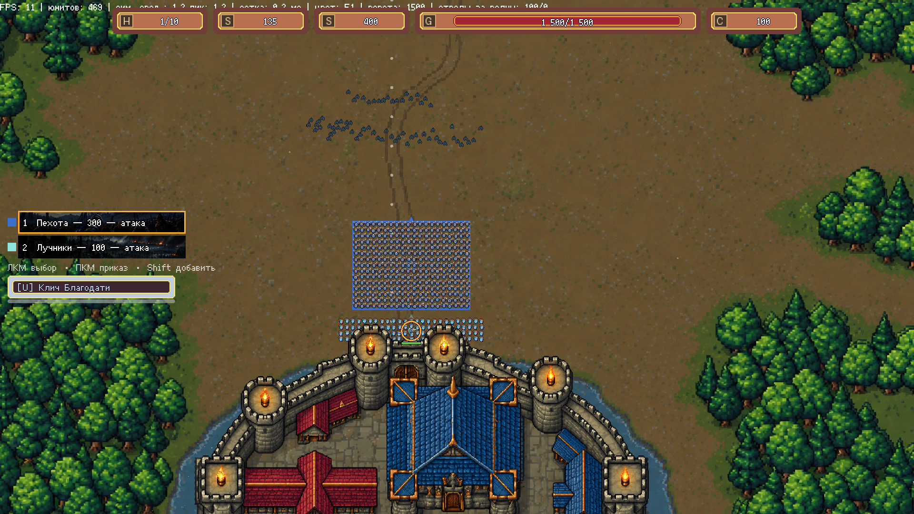

### Хаб, «Дары»

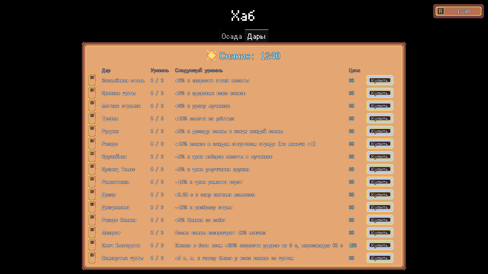

### Хаб, «Дары» с причинами отказа

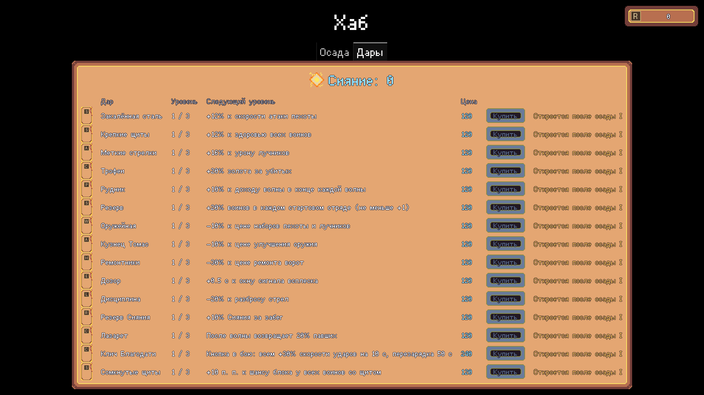

### Хаб, дневник

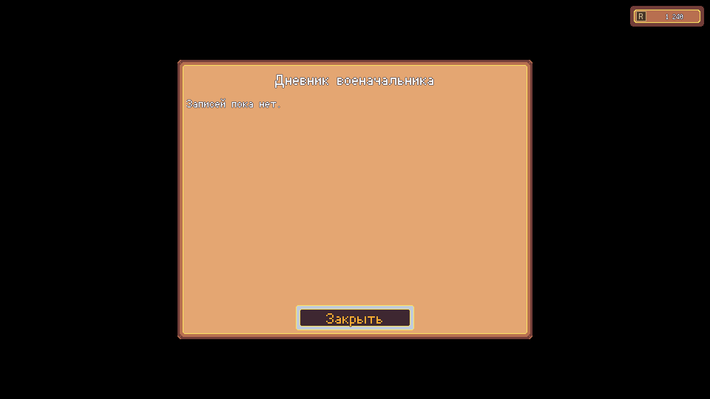

### Хаб, «Осада»

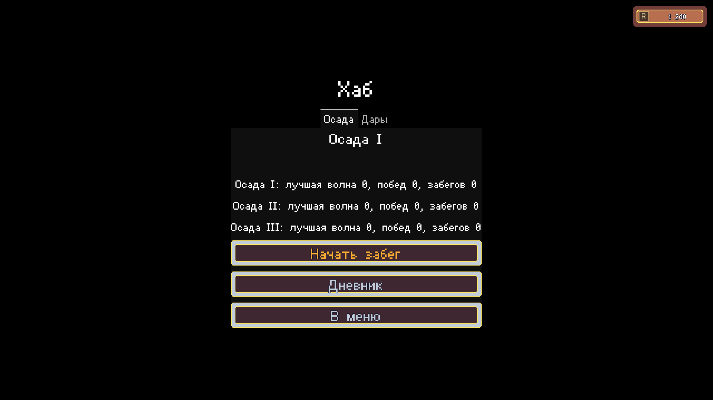

### Главное меню

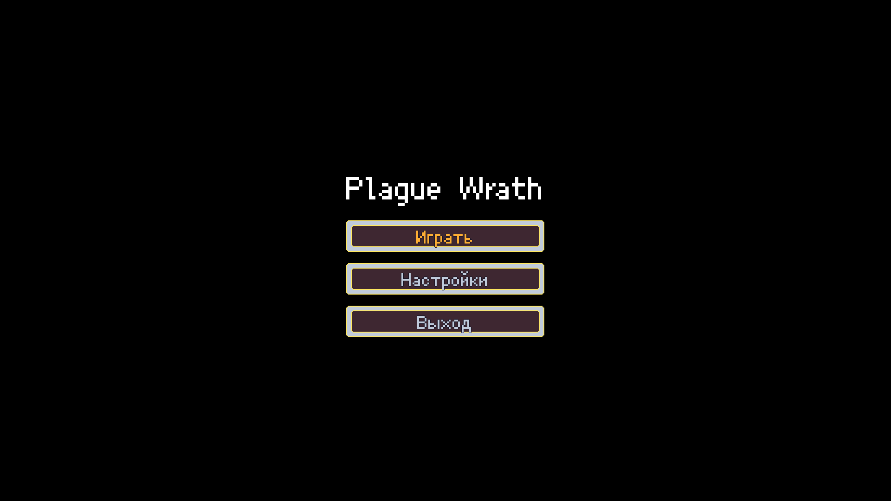

### Настройки: видео

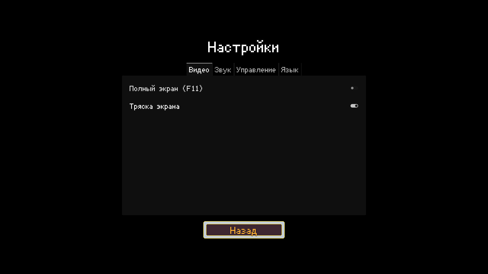

### Настройки: звук

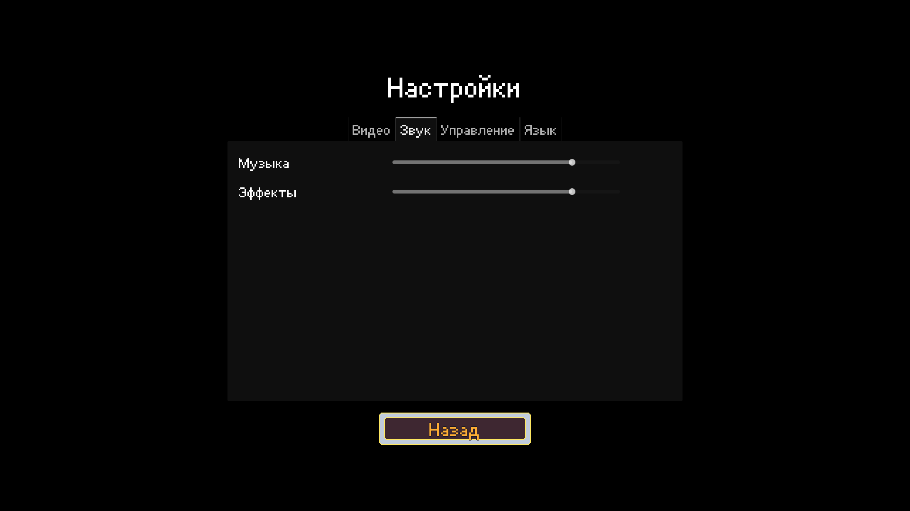

### Настройки: управление

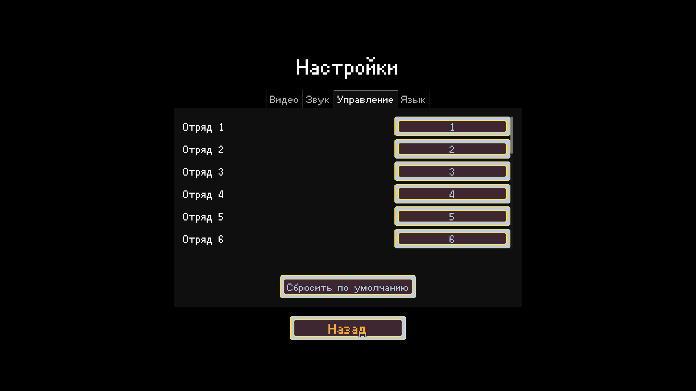

### Меню паузы

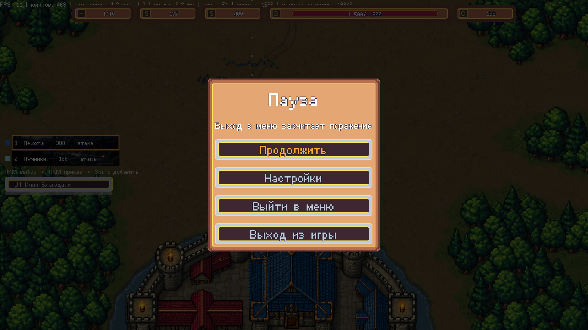

### Выбор карточки

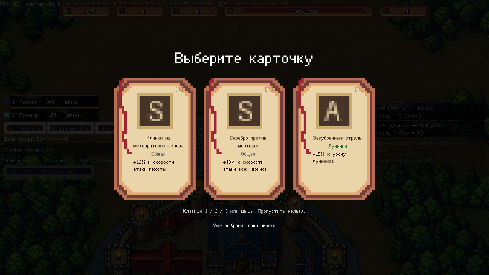

### Баннер конца волны

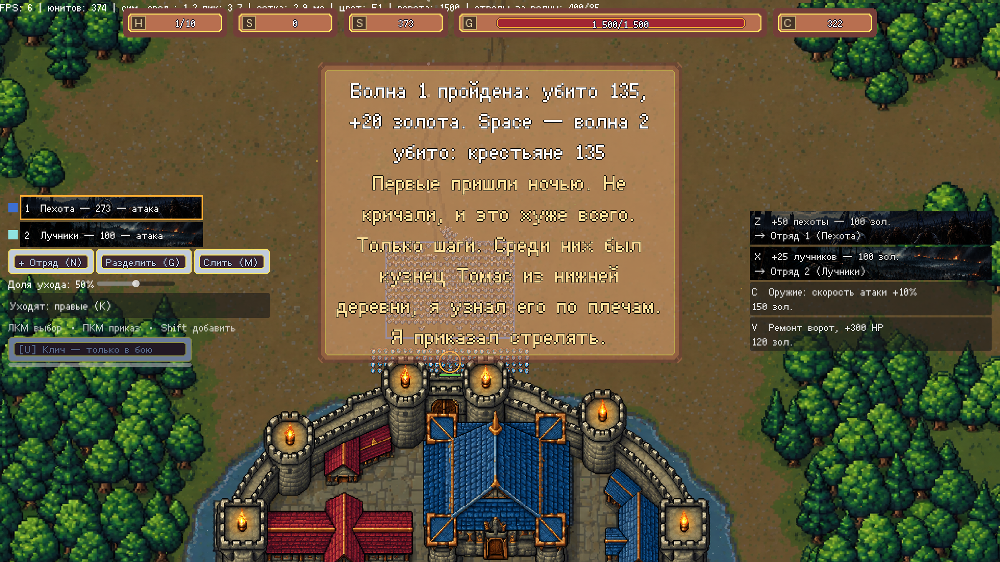

### Экран итога

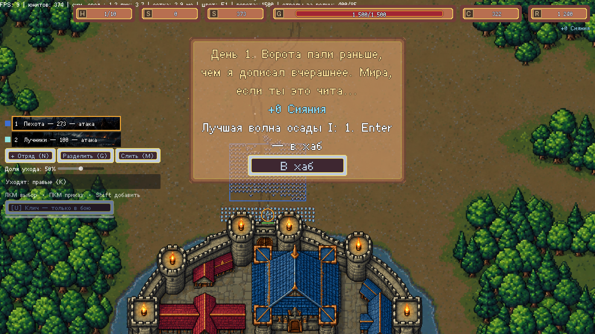
