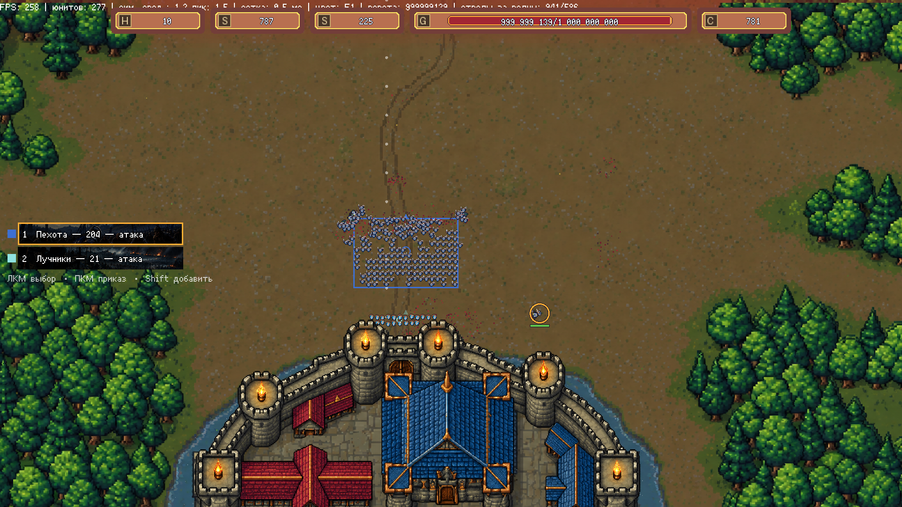
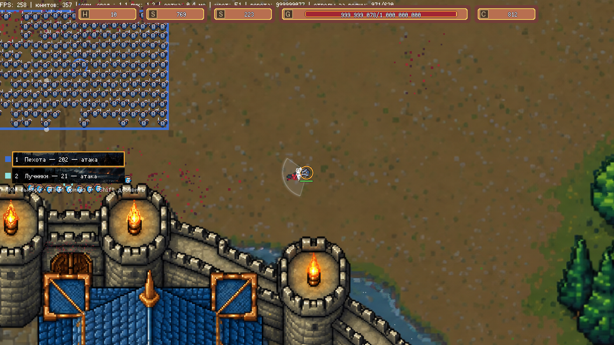
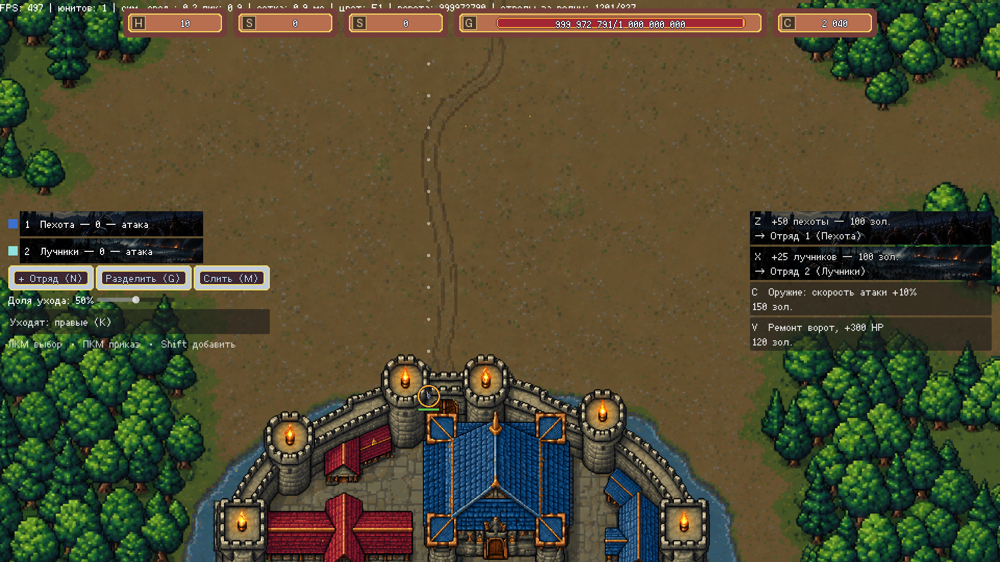
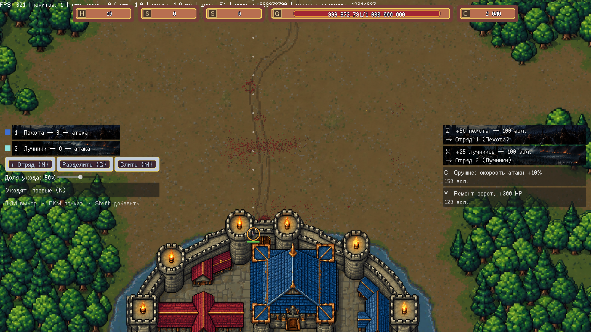

# Задача 23: резня и тряска — снимки 1920×1080

Сделаны `bench/shots_v73_gore.gd <папка> <префикс>` по одному сценарию (волна 10, seed 3, герой бьёт ближайшего), «до» — копия 885347a.

| Сцена | до | после |
|---|---|---|
| Большой бой, волна 10, тик 900 | [до](before_battle.png) | [после](after_battle.png) |
| Удар героя крупно (x2.5, через 5 кадров после добивания) | [до](before_hero_close.png) | [после](after_hero_close.png) |
| Поле после волны (кровь подсохла) | [до](before_field_after.png) | [после](after_field_after.png) |

### Большой бой, волна 10, тик 900

до:

после:

### Удар героя крупно (x2.5, через 5 кадров после добивания)

до:

после:

### Поле после волны (кровь подсохла)

до:

после:

